# BeeGo! - планирование выездных бригад в действии

<p align="center">
  <a href="https://raw.githubusercontent.com/R2NN/scaszc/main/docs/assets/motion/beego-motion.mp4">
    
  </a>
</p>

<p align="center">
  <strong><a href="http://45.152.196.19/">Открыть стенд</a> · <a href="docs/README.md">Техническая документация</a> · <a href="docs/assets/presentation/BeeGo-presentation.pdf">Презентация</a></strong><br>
  <a href="https://raw.githubusercontent.com/R2NN/scaszc/main/docs/assets/motion/beego-motion.mp4">Смотреть полное видео без звука · 3:50</a>
</p>

**От адреса заявки до опубликованного плана смены, который диспетчер может проверить и изменить.**

Мы сделали этот README рассказом о принятых решениях: что видно в продукте, как это обеспечено алгоритмом и почему компоненты устроены именно так. Команды, форматы данных и процедуры развёртывания вынесены в [техническую документацию](docs/README.md): [архитектура](docs/reference/architecture.md), [API](docs/reference/api.md), [алгоритм](docs/reference/planning.md).

Теперь тот же рабочий день связывает **качество исполнителя, время на объекте и изменения в пути**: рейтинг помогает подобрать состав, особенности объекта меняют длительность визита, а авария или закрытая дорога требуют нового проверенного решения. Сетевые события показывают, какие заявки зависят от общей неисправности. Диспетчер видит исходные данные, последствия решения и результат на карте.

<a id="screencast"></a>
## Скринкаст

Рекомендуем начать со скринкаста: он показывает импорт заявок, построение маршрутов, работу со сменой, перепланирование и отчёт. Новые сценарии рейтинга, объектов, аварий и транспортных ограничений показаны ниже на актуальных экранах приложения.

**[Смотреть скринкаст BeeGo](https://drive.google.com/drive/folders/16-bI1dDMEf5oGwzf21izeyWvwMPiTzwm?usp=sharing)**

**[Открыть стенд](http://45.152.196.19/)** · **[Документация](docs/README.md)** · **[Презентация](docs/assets/presentation/BeeGo-presentation.pdf)**

## Структура репозитория

| Каталог | Содержание |
| --- | --- |
| `site/` | Интерфейс, Node API, публичные примеры и JS-тесты |
| `algorithm/` | Python-планировщик, маршрутизация и регрессионные тесты |
| `data/` | Входы, первичные источники, тестовые примеры и полный runtime-комплект |
| `runtime/`, `tools/` | Запуск маршрутизатора и установка проверяемых ресурсов |
| `deploy/` | Поставка на VM, Nginx и systemd |
| `docs/` | Возможности, эксплуатация, техническая справка и актуальные экраны |

[Запуск](docs/operations/quickstart.md) · [Разработка и тесты](docs/development/contributing.md) · [Каталог данных](docs/reference/data-catalog.md) · [Область применения](docs/reference/limitations.md)

## Содержание

| Продукт | Техническая часть |
| --- | --- |
| [01. Карта и рабочее пространство](#workspace) | [08. Архитектура](#architecture) |
| [02. Импорт данных и поиск адреса](#input) | [09. Алгоритм и проверка ограничений](#algorithm) |
| [03. Инженеры и состав смены](#engineers) | [10. Дорожные данные и расписания](#routing) |
| [04. Ход смены](#shift) | [11. События и публикация плана](#events) |
| [05. Перепланирование](#replanning) | [12. Данные аналитики](#analytics-data) |
| [06. Аналитика](#analytics) | [13. Быстрый старт через Docker](#docker-start) |
| [07. Отчёт, AI-помощник и справка](#report) | [14. Развёртывание и проверка стенда](#deployment) |
| [Скринкаст и стенд](#screencast) | [Лицензии компонентов и данных](THIRD_PARTY_LICENSES.md) |

**Новые сценарии:** [Рейтинг и подбор состава](#rating) · [Время и паспорт объекта](#object-time) · [Сетевые события](#network) · [Домашний старт и аварии](#emergency) · [Дороги и метро](#transport)

---

<a id="workspace"></a>
## 01. Карта и рабочее пространство

**▶ Открываем заявку без назначения и разбираем причины по бригадам**


На карте видны точки и маршруты, в левой панели - точные сведения о заявках и бригадах. Нажатие на маршрут связывает геометрию с порядком визитов, временем и составом работ. Мы сохранили карту как рабочий контекст во всех основных разделах: при переходе к смене, аналитике или отчёту диспетчер не теряет день, с которым работает.

**▶ Выбираем бригаду и открываем заявку на её маршруте**

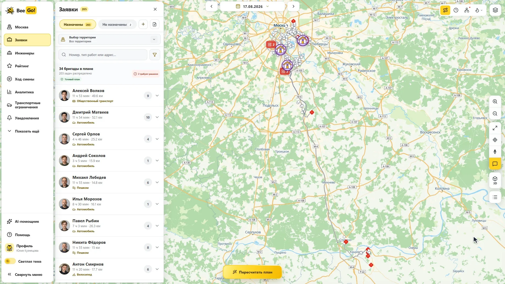

На карте доступны:

- **Заявки и бригады.** Показаны адреса заявок, стартовые точки бригад и маршруты по дорожной сети. Значки различают аварийные заявки, назначенные и оставшиеся в очереди; в выбранном маршруте видны порядок остановок и направление движения.
- **Подробности по нажатию.** Карточка заявки показывает адрес, клиентское окно, вид и норматив работы, оборудование, приоритет, запланированное время прибытия и бригаду. Для заявки в очереди доступны причина и проверка подходящих бригад. Из стартовой точки можно открыть маршрут конкретной бригады.
- **Выбор области и маршрута.** Поиск и фильтры в списке обновляют точки на карте; можно выбрать зону или район, выделить маршрут и приблизить карту к заявке или всем видимым точкам. Легенда объясняет обозначения и позволяет переключать режим выделения маршрута и цвета бригад.
- **Просмотр смены.** Карта показывает положение бригад и пройденную часть маршрута на выбранный момент времени; запланированное завершение и фактическая отметка имеют разные обозначения.
- **Выбор точки для новой заявки.** При ручном добавлении или перепланировании координаты можно указать нажатием на карте; выбранная точка отображается маркером.
- **Управление отображением.** Доступны масштаб, возврат ориентации на север, светлая и тёмная темы, 3D-здания, включение подсказок и показ текущего местоположения с разрешения браузера.

<a id="object-time"></a>
### Время на объектах

**▶ Включаем метки времени и выбираем объект**

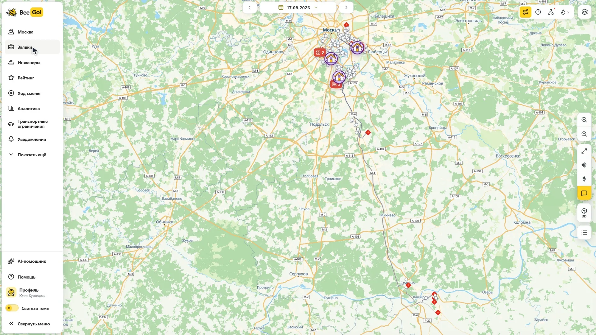

Два одинаковых вида работ могут занять разное время. В одном доме нужно подняться к оборудованию, в другом - проложить дополнительный кабель, в третьем уже есть пригодная линия. Поэтому норматив стал **основой расчёта**, а в план попадает время конкретного визита. Режим времени на карте показывает итоговые минуты и изменение относительно базы; фильтры отделяют длительные визиты от объектов, по которым ещё недостаточно наблюдений. Тепловая карта доступа использует подтверждённые задержки доступа, а не просто большую трудоёмкость заявки.

На оценку также влияют **история фактического времени и обратная связь инженеров**. В завершённом визите фиксируются техническая работа, доступ и ожидание клиента. Пояснение инженера помогает установить причину отклонения: дополнительный объём, сложная диагностика, условия доступа или более простая работа. Измерения и причины связываются с конкретным объектом и местом обслуживания.

**▶ Раскрываем состав длительности конкретного визита**

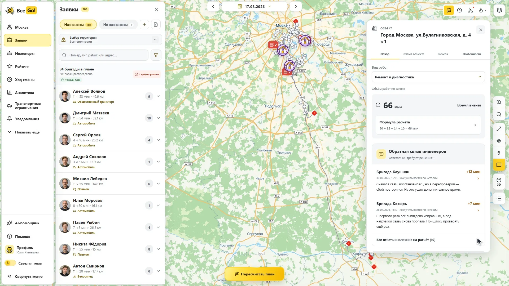

Расчёт разделяет техническую работу, оформление и доступ. Дополнительные устройства, площадки, кабельные работы, состояние линии и подтверждённые особенности меняют соответствующую часть. Этажность и внутреннее устройство здания могут объяснять условия работы, но сами по себе не доказывают задержку. Оформление не умножается на коэффициент технической сложности; дорога считается отдельно. Например, стандартное подключение даёт **60 + 10 = 70 минут**, а тот же вид работ с четырьмя устройствами, тремя площадками и большим объёмом кабеля - **145 + 10 = 155 минут**.

Под формулой видны основания, измеренные визиты и ответы инженеров. **Диспетчер проверяет повторяемость причины и подтверждает область её применения**: например, конкретную линию, узел, подъезд, объект или клиента. В расчёт входят только действующие подтверждённые особенности и сопоставимые измерения, известные к моменту планирования. По умолчанию для исторической поправки нужны как минимум три пригодных визита за последние 120 дней; выбросы отсекаются, а медианное отклонение сглаживается с учётом количества наблюдений. Поправка может как увеличивать, так и уменьшать время.

Для переноса ответов инженеров на будущие визиты по умолчанию нужны как минимум четыре пригодных измерения от двух или более инженеров в разные дни. Система проверяет устойчивость причины и результат на более поздних визитах: поправка должна уменьшать ошибку и сохранять качество действующей оценки. Для ожидания клиента область применения - подтверждённый лицевой счёт. Ручное изменение длительности доступно с указанием причины и пересчётом будущего плана.

### Паспорт и схема здания

**▶ Переключаем обзор, историю визитов и особенности объекта**

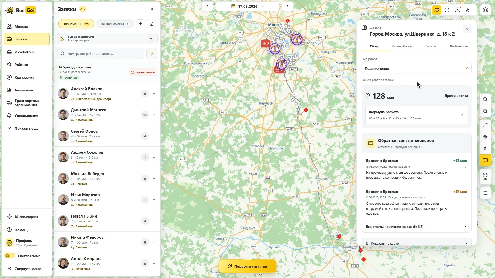

Паспорт связывает оценку времени с объектом: **«Обзор / Схема объекта / Визиты / Особенности»**. Здесь можно проверить состав расчёта, историю посещений, оборудование, сообщения инженеров и условия доступа. Для каждого визита видны плановые сведения и доступные измерения выполнения.

В записи - подключение на улице Шверника: **128 минут вместо базовых 70**. Состав работ добавляет 45 минут, а подтверждённая история повторной диагностики линии - ещё 13 минут. В паспорте раскрываем формулу, сравниваем план и факт прошлых визитов и проверяем подготовку к работе на этом адресе.

**▶ Открываем схему здания, выбираем оборудование и план этажа**

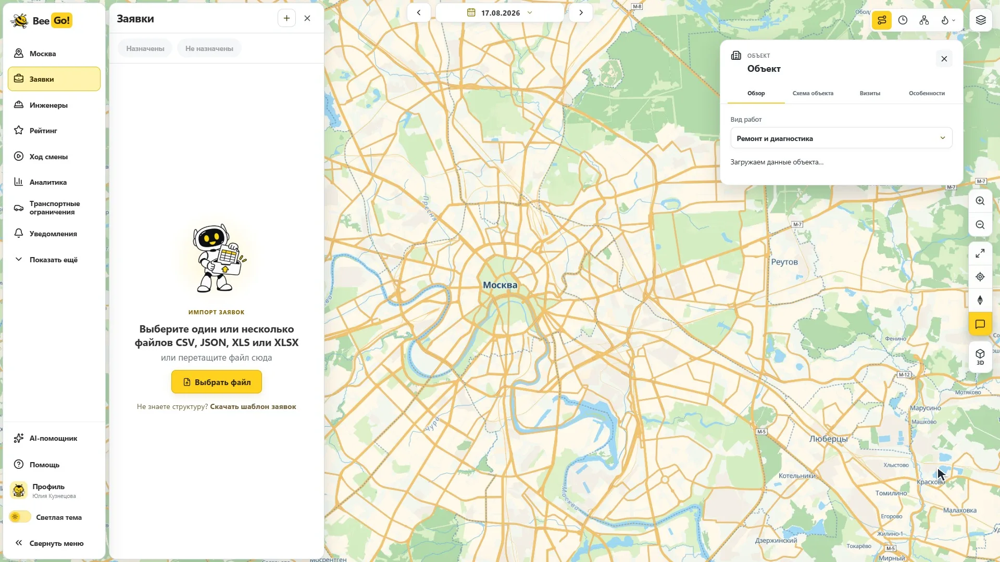

Схема раскрывается на рабочую область, оставляя навигацию доступной. Можно выбрать секцию, перейти на этаж, найти шкаф, стояк и связанную квартиру клиента, затем открыть нужную заявку. Контур и доступные параметры здания опираются на реестр/OSM; внутренние помещения, оборудование и кабели в учебном наборе заданы моделью. Для импортированных и подтверждённых оператором связей доступно их происхождение.

<a id="network"></a>
### Сеть: влияние на заявки

**▶ Проверяем общую неисправность, связанные заявки и историю**


Несколько выездов могут зависеть от одного узла, линии или питания. Обычная карта показывает источник и предупреждения у связанных заявок; режим **«Сеть»** приглушает остальную обстановку и выделяет зависимости. Номера в карточке совпадают с номерами на карте. Пунктир связывает заявку с событием; основание и ID зависимости доступны в карточке.

В карточке диспетчер отмечает **«Проверяется / Подтверждена / Устранена»**, ожидаемое восстановление либо неизвестный срок и решение по каждому выезду: **«Можно выполнять / Ждать восстановления»**. «Пересмотреть план» переводит к согласованию нового окна нужной заявки и проверке расписания.

На исходном наборе 17.08.2026 доступны три учебных узла и связанные заявки. События можно регистрировать и уточнять вручную; подключение живого мониторинга предусмотрено следующим этапом интеграции.

<a id="input"></a>
## 02. Импорт данных и поиск адреса

Заявки и состав инженеров принимаются из CSV/JSON; XLS/XLSX доступны через экран импорта. Сопоставление столбцов, проверка обязательных полей и предпросмотр строк происходят **до** расчёта. Координаты из источника сохраняются; для текстового адреса используется серверный Geoapify.

**▶ Переключаем заявки и инженеров, проверяем назначение столбца**


**▶ Вводим адрес и выбираем объект из подсказок**


Ручная заявка проходит тот же путь: адрес можно выбрать из реестра объектов, внешней подсказки или указать на карте, затем задать работу, приоритет, окно и оборудование. Диспетчер рассчитывает черновик, проверяет назначение и подтверждает новый план.

Импорт поддерживает также факторы длительности и ссылки на объект, подъезд, узел и линию. Сервер проверяет территорию и рассчитывает время по виду и составу работ. Снимок расчёта связывает исходные факторы, версию модели и итоговые минуты с конкретной опубликованной заявкой; изменение модели не переписывает прежние планы.

<a id="engineers"></a>
## 03. Инженеры и состав смены

**▶ Подбираем инженеров по навыкам, оснащению и транспорту**

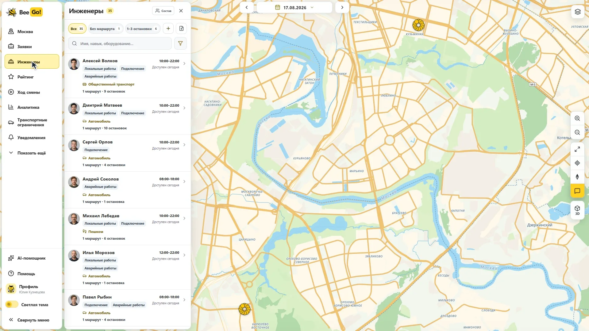

В реестре видны доступность, зона, навыки, транспорт и оборудование. Фильтры можно сочетать: например, найти автомобилистов с допуском к аварийным работам и диагностическим набором. В карточке выбранного инженера доступны его остановки и загрузка; управление составом позволяет включить резерв в смену.

**▶ Раскрываем карточку инженера и его назначения**


Допуск и оснащение бригады определяют, можно ли назначить ей заявку. Алгоритм отсекает несовместимые пары до вычислительно затратного поиска, а интерфейс показывает причину исключения.

<a id="rating"></a>
### Рейтинг по завершённым визитам

**▶ Фильтруем оценки и раскрываем подробности отзыва**

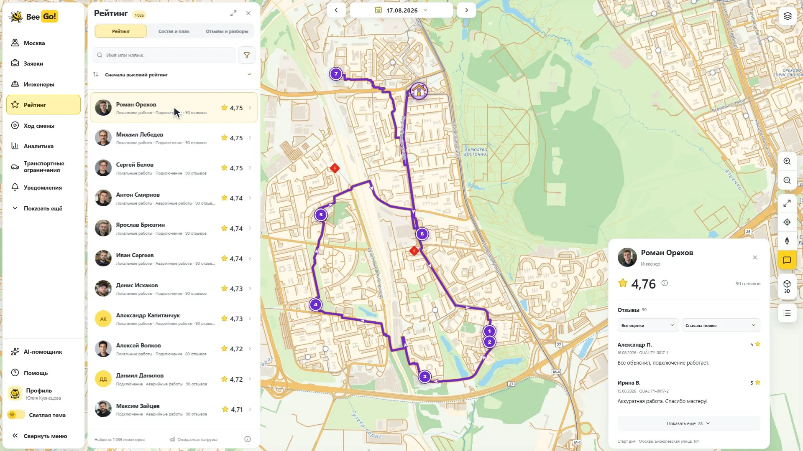

Отзыв относится к **специалисту, выполнившему работу**: исполнитель определяется по подтверждённому завершённому визиту. В карточке доступны исходные звёзды, текст клиента, адрес и дата работы, число оценок и распределение по звёздам. Фильтр помогает быстро найти негативные отзывы, а нажатие на оценку раскрывает подробности визита.

Мы используем сглаженную оценку: `(сумма учитываемых звёзд + 20 × 4,20) / (число отзывов + 20)`. Несколько первых пятёрок не ставят новичка без истории заведомо выше устойчиво хорошего специалиста. Средняя оценка и число отзывов показаны рядом, а формула раскрывается отдельно.

**▶ Изучаем оценку, переписку и фото, затем принимаем решение по отзыву**

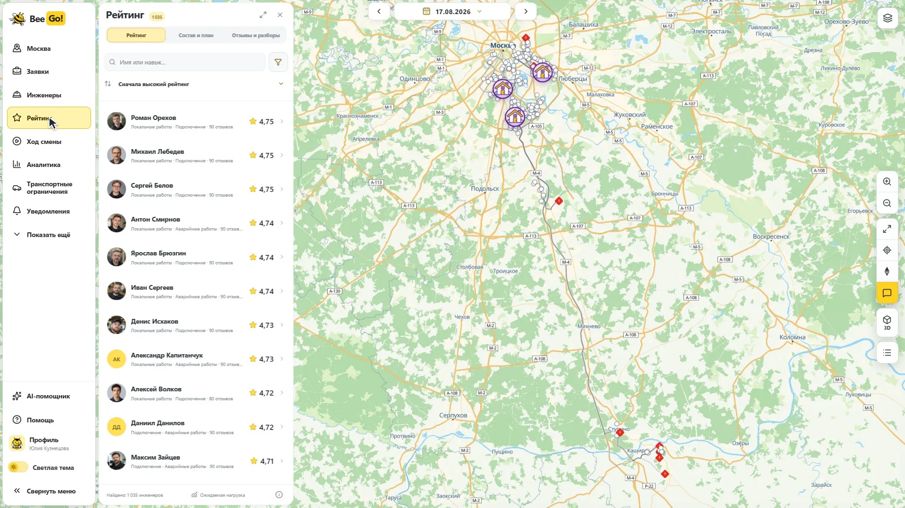

Спорный отзыв открывается в разборе: **исходная оценка → переписка и вложения → решение с основанием → обновлённый рейтинг**. В записи клиент подтвердил исправное подключение, а низкая оценка относилась к ожиданию назначения. Диспетчер изучает переписку и исключает этот отзыв из расчёта рейтинга инженера; исходная оценка клиента остаётся доступной. Для уточнения самих звёзд предусмотрено подтверждение клиента. Пожелание снова пригласить специалиста и отказ после негативного опыта учитываются как предпочтения конкретного клиента/адреса при подборе.

### Состав с приоритетом качества

**▶ Сдвигаем нижнюю границу рейтинга с 4,60 до 3,60 и рассчитываем новый состав**

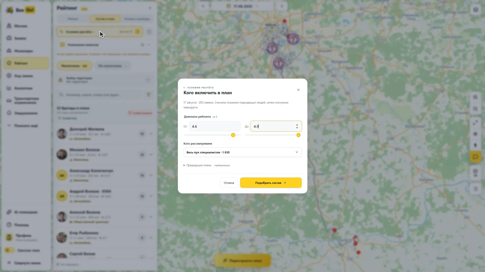

После изменения диапазона на **3,60-4,90** подтверждаем предложенных специалистов. Запись непрерывно показывает подготовку данных, проверку маршрутов и готовый результат нового расчёта.

Дополнительный режим рассматривает текущий штат либо **условно неограниченный ресурс через расширенный пул профилей**. Диспетчер задаёт нижнюю и верхнюю границы рейтинга, получает предложение конкретных специалистов и подтверждает его до расчёта маршрутов. Резерв не означает универсального инженера: сохраняются территория, транспорт, смена, стартовая точка, навыки и оборудование соответствующего профиля.

**▶ Смотрим рассчитанный состав и заявки без назначения**

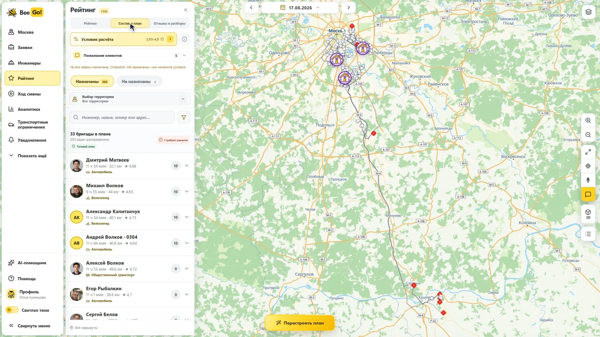

Затем система проверяет полные маршруты и уточняет число занятых специалистов. Результат показывает покрытие, состав и заявки, для которых нужно решение диспетчера. В показанном сценарии диапазон **3,60-4,90** и расширенный пул дали проверенный план **203/205**; у двух оставшихся заявок можно открыть причины и рассмотреть изменение окна или дополнительный ресурс.

**Схема · статичная иллюстрация**


Путь качества соединяет оценку выполненной работы, решение по отзыву, диапазон рейтинга и конкретный состав. После подтверждения сервер сверяет источник и доступность людей, затем проверяет маршруты с выбранными специалистами. [Технический контракт](docs/reference/rating-workflow-and-planning.md) раскрывает состояния, алгоритм и параметры API.

<a id="shift"></a>
## 04. Ход смены

**▶ Выбираем ускорение и проигрываем движение смены**

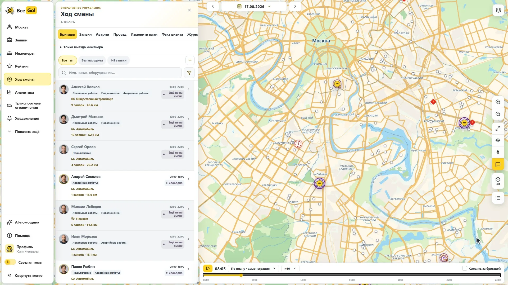

В разделе **Ход смены** доступны маршруты бригад и заявки, шкала времени, события и фактические отметки. Проигрывание времени показывает состояние опубликованного плана в выбранный момент.

<a id="emergency"></a>
### Домашний старт и аварийный выезд

**▶ Выбираем домашнюю точку и открываем маршрут инженера**

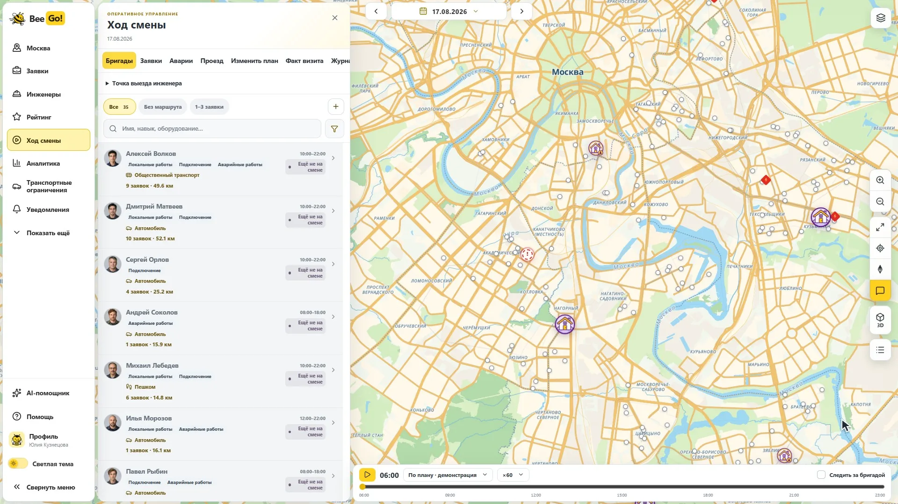

План учитывает **офисный или домашний старт**, время начала смены и транспорт инженера. На учебном дне два существующих специалиста выезжают из дома; адреса в этом наборе сценарные. Для совпадающего исходного набора домашний старт увеличивает покрытие с **203/205 до 204/205** при тех же навыках и клиентских окнах.

**▶ Перехватываем инженера в пути и подтверждаем аварийный выезд**

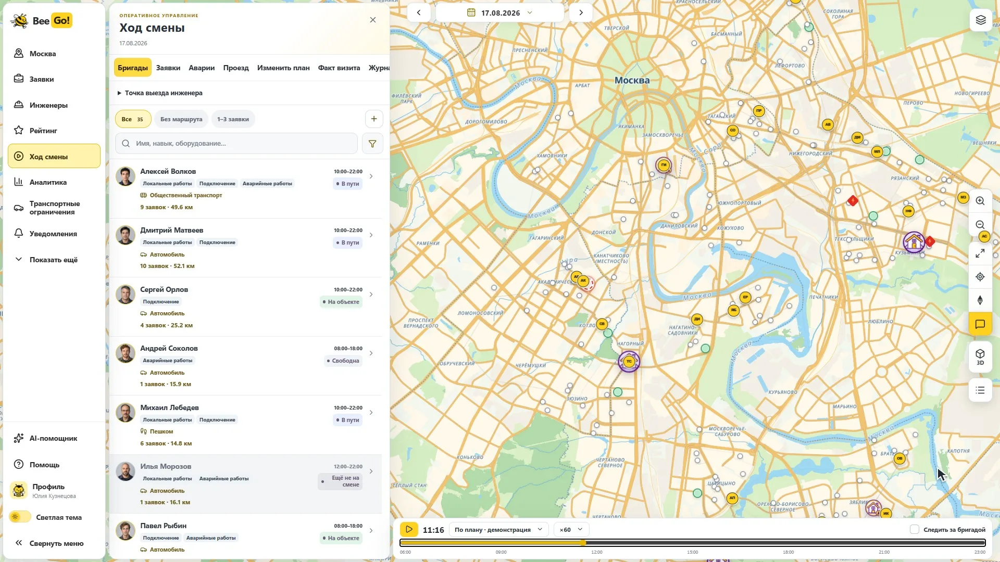

При аварии важна **текущая ситуация**, а не утренняя стартовая точка. Для инженера в дороге система определяет положение на сохранённой геометрии и проверяет перехват от этого места. Если он работает на адресе, сначала сохраняется завершение текущей заявки, затем начинается аварийный выезд. При перехвате прежний адрес назначения может быть передан другому допущенному инженеру; получатель и последствия для остальных работ видны в решении. Домашний резерв рассматривается отдельно, с его реальной доступностью.

Фиолетовая линия показывает оставшийся исходный путь, красная - выезд к аварии и продолжение дня. Карточка соединяет прибытие, выбранного инженера, переданные заявки и последствия для расписания. Проверенные предложения появляются по мере готовности, диспетчер сравнивает их и подтверждает подходящее. Перед отправкой система уточняет маршрут выбранного инженера от текущего момента и проверяет оставшуюся смену.

<a id="transport"></a>
### Проезд: дороги и метро

**▶ Встречаем закрытие дороги и сравниваем путь с объездом**

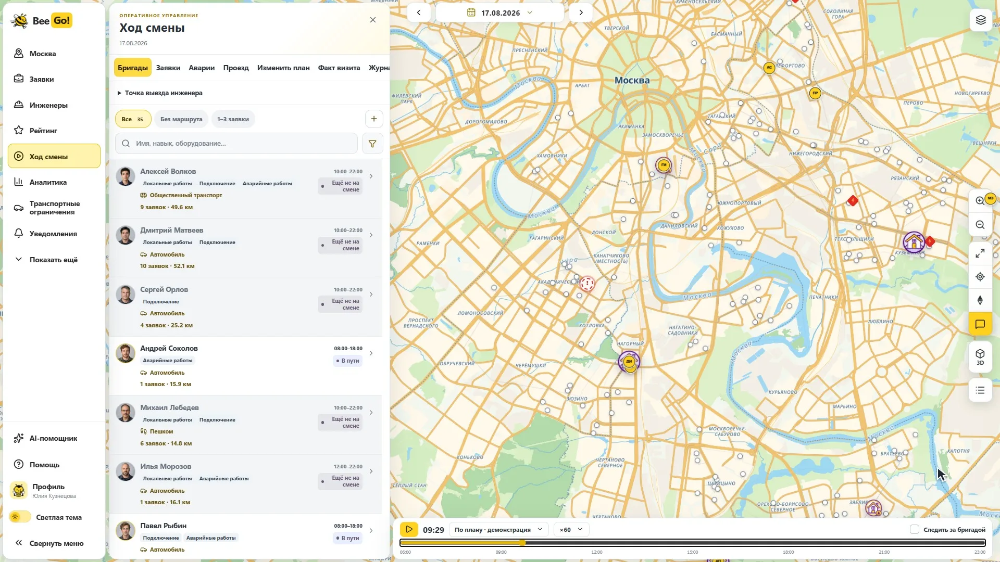

Транспортная проблема появляется на **общей карте смены**, даже если оператор смотрит бригады или заявки. Новое активное событие приближает место проблемы и открывает «Проезд». Нажатие на ограничение показывает затронутых инженеров и заявки, старое и новое время прибытия и сравнение маршрутов: **фиолетовый - прежний, зелёный - проверенный новый**. Система рассчитывает последствия на момент события; применение остаётся отдельным решением.

Оператор может задать время начала, окончание на следующий день либо неизвестный срок. Дорогу выбирают по точкам, перетаскивают границы или рисуют кистью; линия привязывается к существующей дорожной сети. Случайное соседнее ребро, разрыв и большой непрошенный объезд не сохраняются как частичное закрытие. Метро выбирается по настоящим станциям: первый клик выделяет станцию, второй - участок этой ветки с промежуточными станциями. Отдельно поддерживаются движение, вход и пересадка, с разрешённым направлением ограничения.

**▶ Задаём границы закрываемой дороги прямо на карте**

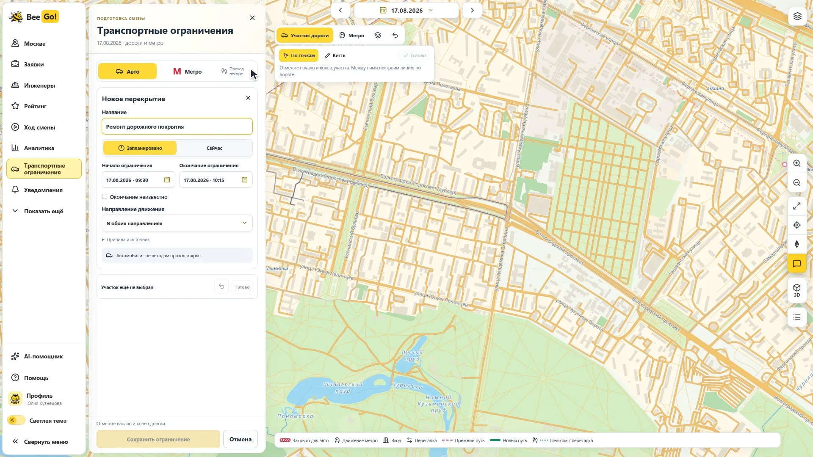

**▶ Выбираем станции и подсвечиваем закрываемый участок ветки**

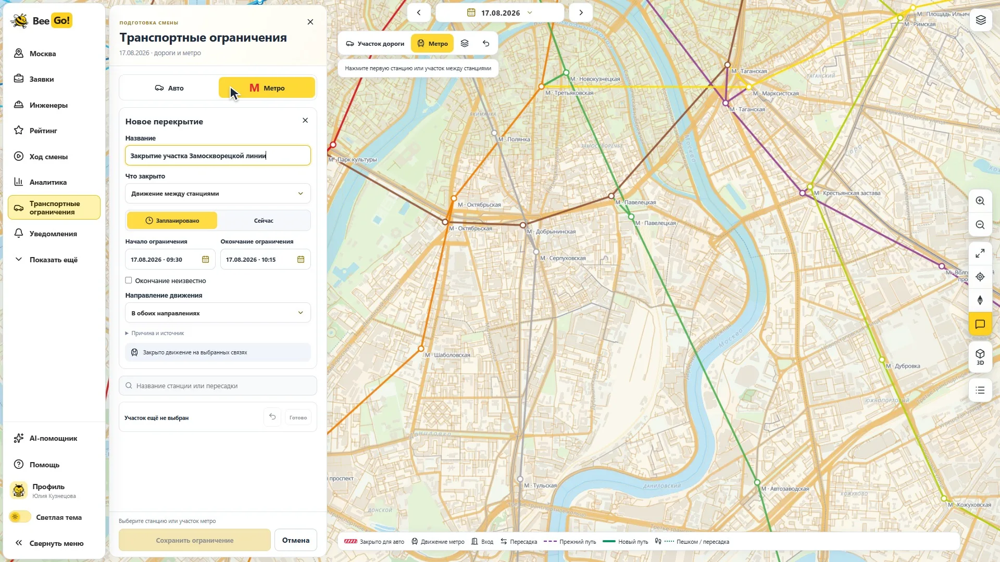

**▶ Сравниваем прежний путь через метро и доступный обход**

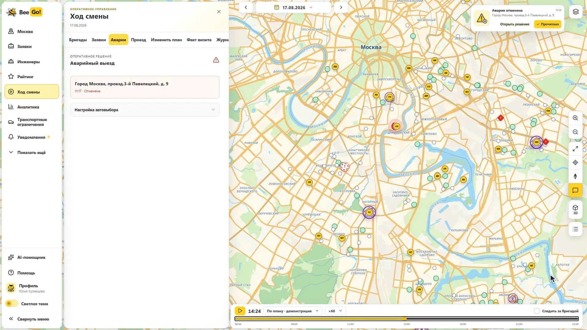

Инженер сохраняет свой транспорт. При закрытии метро проверяются доступные перегоны, входы, пересадки, часы работы и ожидание известного открытия. В сравнении видны исходный путь, обход, время прибытия и прогресс расчёта. Транспортные ограничения учитываются и при аварийном выезде.

Воспроизведение при новом решении по умолчанию замедляется до ×1, а выбор скорости всегда доступен. После применения возвращается прежнее ускорение, если оператор не выбрал другое. В учебном прогоне два транспортных события - дорога в **09:30** и метро в **14:25**; авария поступает в **11:17**. Перемотка на **06:00** запускает новый чистый прогон без обновления страницы, сохраняя прошлые запуски и их историю.

<a id="replanning"></a>
## 05. Перепланирование

**▶ Меняем окно клиента, рассчитываем и публикуем обновлённый план**

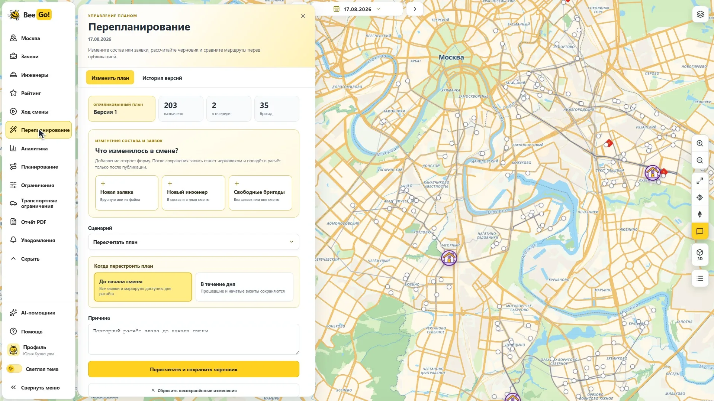

Новая авария, отмена, недоступность инженера, изменение окна или добавление ресурса оформляются как событие. Отмена снимает заявку с будущего маршрута; опубликованный план меняется только после проверки и подтверждения черновика. Для новой заявки планировщик сначала ищет точную вставку в действующие маршруты. Если она не найдена, он заново собирает будущую часть дня, сохраняя уже начатые визиты.

В записи меняем окно заявки **№23637** с **20:00-22:00** на **10:00-22:00**. После расчёта и публикации покрытие растёт с **203/205 до 204/205**. Открываем получившее назначение: **Даниил Данилов**, прибытие и начало в **14:37**, окончание в **16:45**.

**▶ Выбираем прежний план и подтверждаем восстановление**

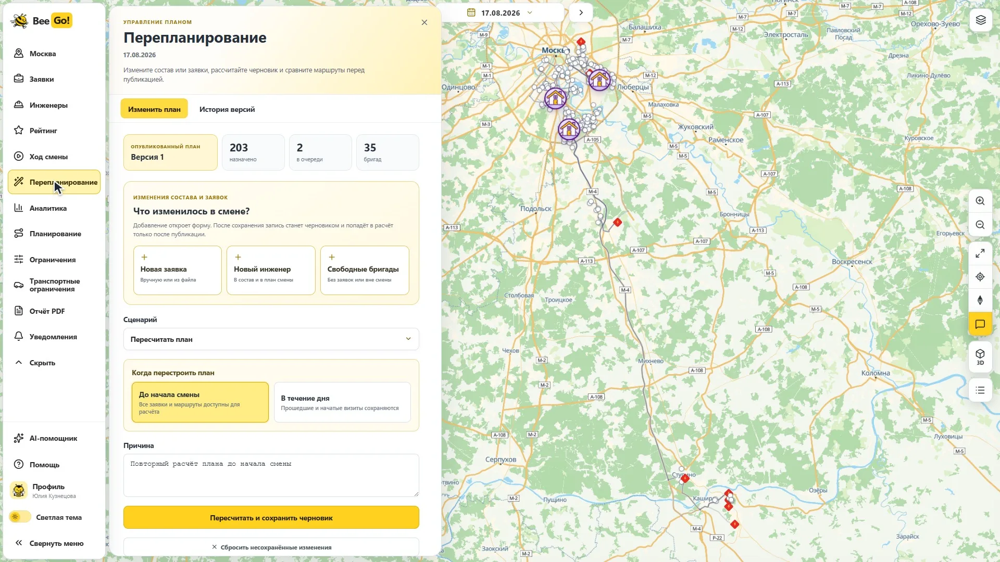

После публикации видны обновлённые назначения и номер плана. В истории можно сравнить изменения и восстановить выбранный вариант. Диспетчер проверяет последствия для клиентских окон и маршрутов перед подтверждением.

<a id="analytics"></a>
## 06. Аналитика

### Смена

**▶ Открываем итоги дня и просматриваем показатели**

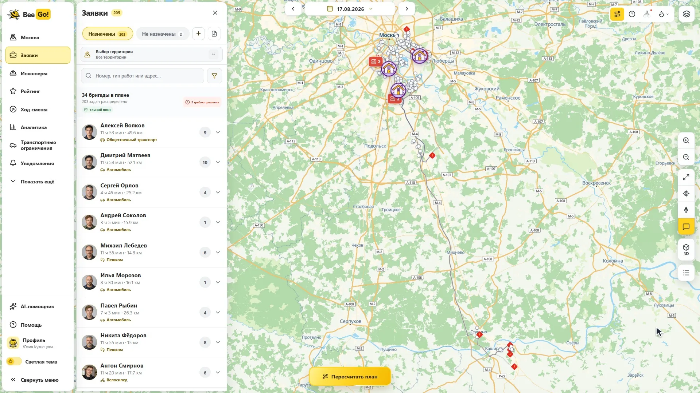

Для контрольного дня **17.08.2026** исходный план с переменной длительностью назначает **203 из 205** заявок, включая **15 из 15 срочных**, задействует **34 из 35** бригад; суммарный маршрут - **1 436,4 км**. Сводка соединяет покрытие, очередь, пробег и число бригад. У каждой заявки в очереди можно открыть причины и подходящие действия: согласовать окно, изменить состав или уточнить условия работы.

В аналитике есть **сравнение с FCFS** - распределением в порядке поступления на тех же входных данных. Интерфейсная модель FCFS использует приближённые расстояния и типовые скорости, основной план - локальные дороги и расписания. На экране видны покрытие, назначенные заявки и затраты времени для обоих подходов.

| Элемент | Что даёт диспетчеру |
| --- | --- |
| Покрытие, аварии, очередь | Проверить результат по всем заявкам и отдельно по срочным работам. |
| Бейзлайн FCFS | Увидеть, сколько заявок назначает простое правило поступления на тех же входных данных. |
| Зоны и состав смены | Найти территории с нехваткой подходящих бригад и оценить запас ресурсов. |
| Структура времени и рекомендации | Отличить время работы от дороги и простоя; перейти от показателя к конкретному действию. |

### История

**▶ Переходим к истории и динамике рассчитанных дней**

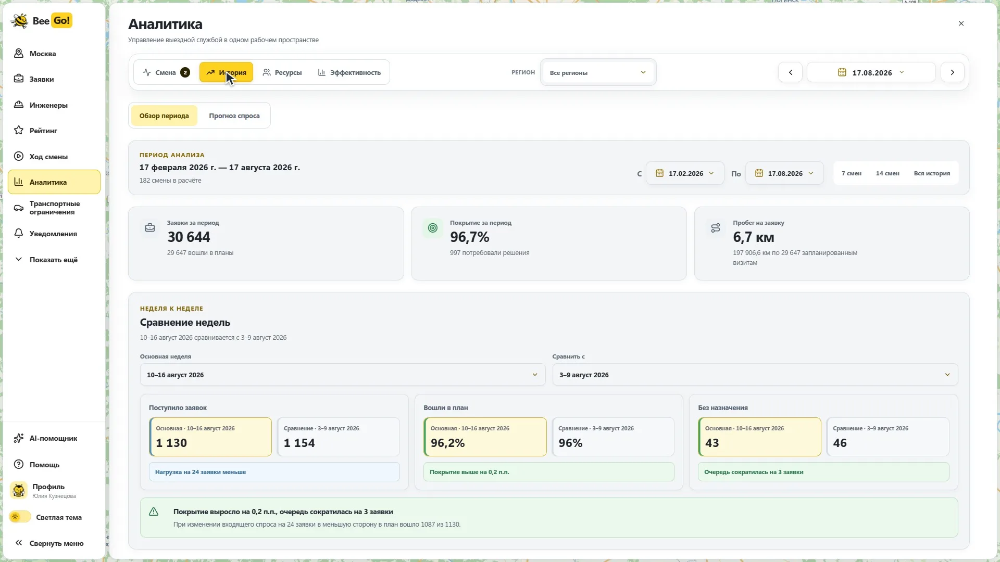

История охватывает **182 рассчитанных дня** с 17.02 по 17.08.2026. Фильтр периода, покрытие, очередь и пробег на заявку показывают динамику; сравнение соседних периодов помогает заметить изменение нагрузки до просмотра отдельных смен.

Список дней позволяет открыть дату с необычной очередью. Ниже система формирует объяснения по всей истории: называет повторяющийся дефицит навыка и зоны, число затронутых заявок и дней, затем предлагает действие. Это полезнее общего предупреждения о снижении процента покрытия.

Разрез по территориям связывает покрытие, пробег и очередь с местом возникновения проблемы. Необычные изменения сопоставляются с типичными значениями для аналогичных дней недели, поэтому разовый пик можно отделить от повторяющегося дефицита.

### Прогноз спроса

**▶ Открываем прогноз спроса и его разрезы**


Прогноз показывает ожидаемое число заявок, диапазон и ошибку на истории. Верхняя граница помогает оценить резерв на пиковый спрос. Разрезы по навыкам и территориям переводят нагрузку в потребность в составе; выбранных специалистов можно включить в последующий расчёт адресных маршрутов.

Разрезы по зонам и навыкам переводят число заявок в состав смены. Почасовой профиль показывает, когда нужен резерв, а пояснение модели раскрывает использованные признаки: календарь, средний спрос и долю работ по подключению.

### Ресурсы

**▶ Проверяем состав и загрузку бригад**


Здесь видны средняя загрузка, свободные часы и бригады без маршрута. Реестр можно фильтровать по зоне, навыку, транспорту и состоянию. Для каждого инженера показаны загрузка, назначенные работы и причина, по которой ему предлагается действие или оставляется резерв.

Временная диаграмма показывает работу, раннее прибытие и свободное окно на общей шкале 08:00-22:00. По ней видно, где именно возникает простой и можно ли рассматривать бригаду для новой заявки; окончательное назначение всё равно проходит расчёт и валидацию.

### Эффективность

**▶ Смотрим эффективность плана и расчёт стоимости**

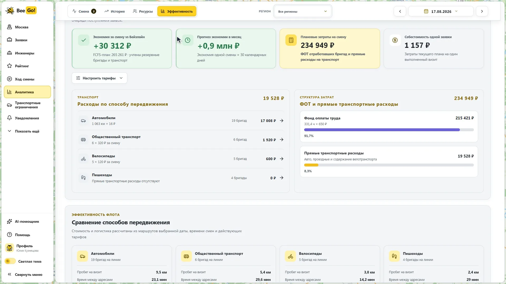

Финансовая модель переводит плановые часы и пробег в стоимость по редактируемым ставкам. Видны стоимость смены и заявки, ФОТ, транспорт по видам и сравнение с FCFS. Месячная проекция рассчитывается по выбранным тарифам; изменение ставки сразу обновляет оценку затрат.

Сравнение видов транспорта показывает пробег, время и стоимость визита. Для длинных маршрутов система называет **ограничивающую заявку** и объясняет, что повлияло на путь: окно клиента, навык, зона или доступный транспорт. Это позволяет обсуждать конкретный маршрут, а не только его общий километраж.

### Точность времени работы

**▶ Изучаем точность длительности на завершённых визитах**

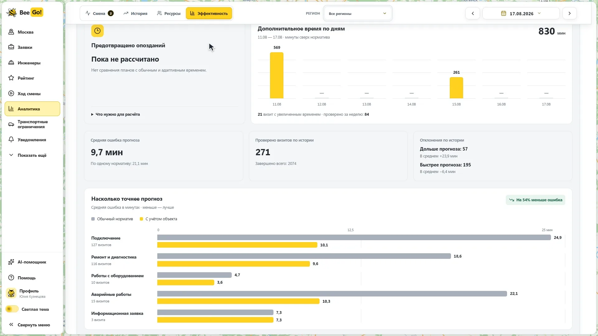

Здесь фиксированный норматив, адаптивная оценка и доступная обученная модель сравниваются **на одних сопоставимых завершённых визитах**. Показаны ошибка в минутах, размер выборки, случаи недооценки и переоценки, а также разрез по видам работ. Для проверки используются полные измерения и прогнозы, известные до начала работы. По результату можно перейти к времени на объектах и изучить причины отклонений.

<a id="report"></a>
## 07. Отчёт, AI-помощник и справка

**▶ Формируем PDF и открываем страницы отчёта**

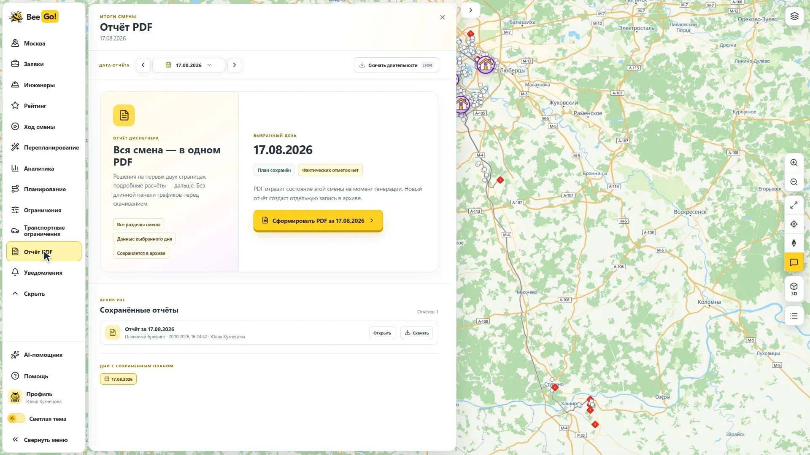

**[Открыть текущий PDF-отчёт за 17.08.2026](docs/assets/beego-report-2026-08-17.pdf)** · 19 страниц.

PDF собирается на сервере из сохранённой ревизии смены: итог, маршруты, очередь, ресурсы, события и факты. Новый выпуск попадает в архив отдельной записью; старый не перезаписывается. Итог и контрольные точки находятся в начале, детализация маршрутов - дальше.

Отчёт включает сохранённые оценки длительности и их основания. Число страниц зависит от состава дня; внутри приложения доступен предпросмотр и скачивание того же PDF. Изменение модели времени после публикации не меняет уже выпущенный документ.

**▶ Задаём вопрос AI-помощнику по текущей смене**

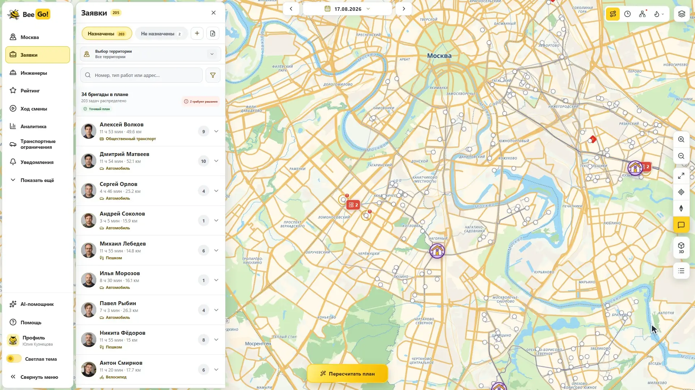

AI-помощник добавлен как необязательная поддержка оператора: если в маршруте, показателе или событии трудно разобраться, можно задать вопрос по выбранной смене. Он получает ограниченный снимок данных и поясняет его; публикацию плана, расчёт и цифры PDF определяют отдельные функции системы. Ключ Yandex AI Studio хранится на сервере.

Уведомления собирают результаты расчётов, импорта и важные события смены. Из карточки события можно перейти к решению, а обработанные сообщения отметить прочитанными. Справка проводит по интерфейсу; профиль позволяет настроить отображаемые данные, аватар и оформление.

**▶ Разбираем уведомления о событиях смены и отмечаем прочитанное**

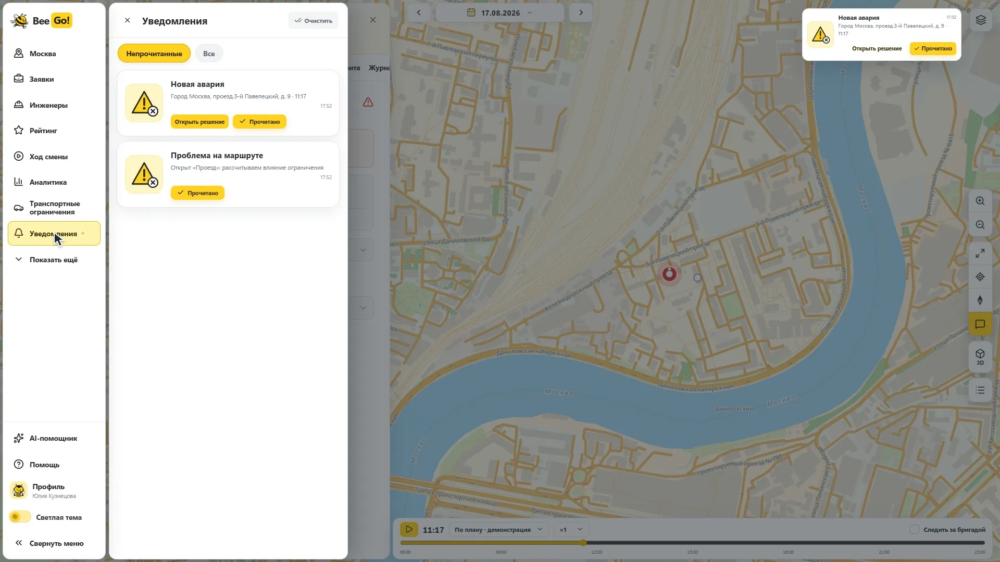

**▶ Находим пошаговую инструкцию в центре помощи**

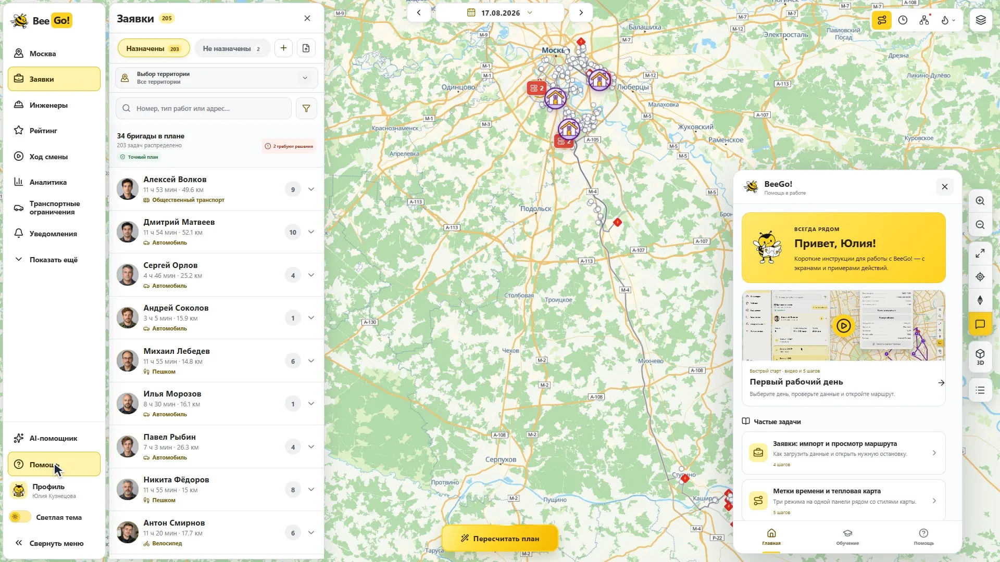

**▶ Открываем настройки профиля и выбор аватара**


---

<a id="architecture"></a>
## 08. Архитектура

**Схема · статичная иллюстрация**

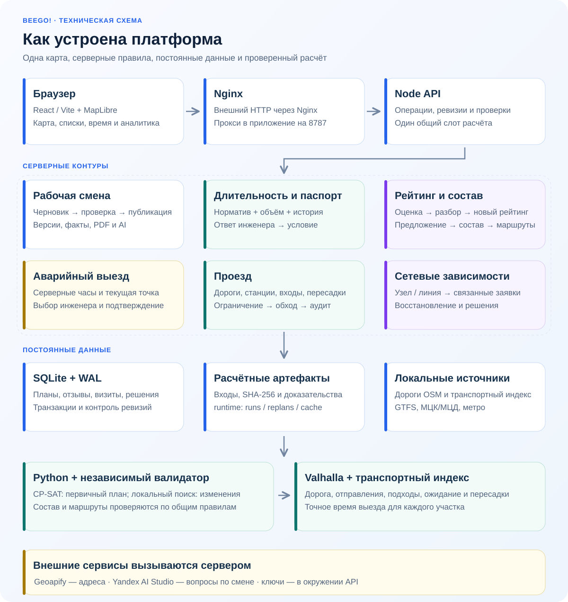

Браузер показывает карту, списки, аналитику и результаты операций. Nginx отдаёт интерфейс и направляет запросы `/api` в **один процесс Node API**. Сервер хранит операционную смену, версии, события и фактические отметки в SQLite; расчёт запускает в Python-процессе и передаёт ему локальные дорожные и транспортные данные. Начальный расчёт и предпросмотр перепланирования занимают один общий вычислительный слот. Остальные пользователи могут просматривать сайт во время расчёта.

Все основные сценарии доступны в одном приложении с постоянной картой:

| Возможность | Данные | Рабочее действие |
| --- | --- | --- |
| Длительность и паспорт | Состав работы, измерения и подтверждённые условия | Оценить время визита и проверить основания. |
| Рейтинг | Завершённые визиты, оценки, переписка и решения по отзывам | Подобрать состав с приоритетом качества и рассчитать маршруты. |
| Сетевой контекст | Узлы, линии, связанные заявки и статус восстановления | Определить доступные работы и согласовать перенос окна. |
| Проезд и аварии | Ограничения сети, положение инженера и проверенные варианты | Выбрать обход или направить инженера на аварию. |

Поиск адресов обращается к Geoapify через API. PDF собирается сервером из сохранённого плана; AI-помощник получает снимок смены через Yandex AI Studio. Ключи внешних сервисов хранятся на сервере.

| Компонент | Роль и причина выбора |
| --- | --- |
| React/Vite + MapLibre | Быстрый интерактивный обзор карты, списков и временной шкалы без переноса правил допустимости в браузер. |
| Nginx | Отдаёт собранный интерфейс и проксирует API на одной VM. |
| Node API | Принимает действия диспетчера, управляет одним слотом расчёта, проверяет статус результата и публикует версии. |
| SQLite | Транзакционно хранит планы, черновики, факты и архив отчётов; для одного небольшого стенда достаточно одной базы. |
| Python + OR-Tools | Первичный CP-SAT поиск, событийный точный поиск и независимая проверка плана отделены от интерфейса. |
| Valhalla + транспортный индекс | Локальные дороги OSM, GTFS, МЦК/МЦД и метро дают повторяемый расчёт без оплаты каждого массового дорожного запроса. |
| Geoapify | Подсказки адресов и геокодирование; не выбирает дорожный маршрут для проверки плана. |
| PDF и Yandex AI Studio | PDF воспроизводится из сохранённой ревизии; ответы AI не меняют план и расчётные показатели. |

<a id="algorithm"></a>
## 09. Алгоритм и проверка ограничений

**Схема · статичная иллюстрация**

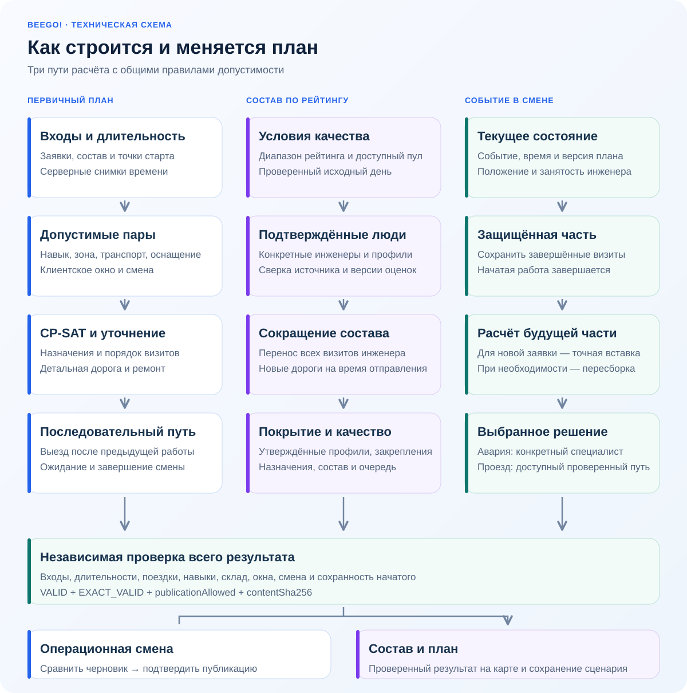

На схеме три пути. **Первичный расчёт** проходит от снимков длительности и допустимых пар через CP-SAT к детальным поездкам и локальной коррекции. **Состав по рейтингу** получает подтверждённых специалистов и проверяет переносы визитов с освобождением маршрутов. **Событийный расчёт** работает от опубликованного плана и текущего состояния: сохраняет начатое, для новой заявки проверяет вставку и при необходимости пересобирает будущую часть. Все результаты проходят независимый валидатор; операционная публикация остаётся явным действием диспетчера.

Для неизменённого контрольного набора API использует сохранённый проверенный результат. Новые входные данные запускают Python-планировщик, а событие в течение дня - пересчёт будущей части опубликованного маршрута.

### 9.1. Отбор допустимых пар

Для каждой пары заявки и инженера проверяются создание заявки к моменту расчёта, доступность человека, территория, навык, допустимый транспорт, личное многоразовое оборудование и жёсткое закрепление. Затем проверяется теоретическое пересечение окна начала работы со сменой с учётом норматива. Причины отклонения сохраняются кодами, чтобы необслуженная заявка получала объяснение.

Общее оборудование учитывается как ограниченный ресурс по территории; суммарное назначение не превышает доступное количество. Норматив задаёт базу по виду работы, затем сервер учитывает её состав и подтверждённые условия объекта. В `Job.service_duration_min` попадает итог снимка, а не одно фиксированное число для всех похожих заявок. Дорога рассчитывается отдельно.

### 9.2. Как соблюдаются ограничения ТЗ

Правила включены в модель поиска, а [отдельный валидатор](algorithm/src/beeline_planning/validator.py) повторно проверяет **готовый план по исходным данным и расчётам поездок**. Результат проверки основан на данных и ограничениях; для нарушений возвращаются конкретные коды.

| Правило | Как не допускаем нарушение при поиске | Что независимо проверяется перед публикацией |
| --- | --- | --- |
| Каждая известная заявка имеет ровно один итог | Для заявки CP-SAT задаёт ровно один исход: назначение инженеру либо постановка в очередь. Заявка, созданная позже момента расчёта, ещё не участвует. | Нет дублирования, одновременного назначения и очереди, пропавших и неизвестных заявок (`DUPLICATE_ASSIGNMENT`, `JOB_RESULT_MISSING` и др.). |
| Квалификация и территория | В граф допускаются только доступные инженеры своей зоны с нужным навыком. | Для каждого визита заново сопоставляются инженер, зона, навык и доступность (`ZONE_MISMATCH`, `SKILL_MISSING`, `ENGINEER_UNAVAILABLE`). |
| Транспорт | Требование заявки сопоставляется с режимом инженера до создания пары. | Совпадение разрешённого транспорта и режима фактического дорожного ответа (`TRANSPORT_MISMATCH`, `ROUTE_MODE_MISMATCH`). |
| Личное и общее оборудование | Личный многоразовый комплект проверяется для пары; общий расходуемый запас ограничен суммой назначений по зоне. | Достаточность у инженера и суммарный лимит склада (`PERSONAL_EQUIPMENT_MISSING`, `SHARED_INVENTORY_EXCEEDED`). |
| Окно клиента и смена | Время старта работы - переменная в закрытом клиентском окне; дорога, ожидание и норматив должны уложиться в смену. | Начало не раньше прибытия и внутри окна; окончание работы до конца смены (`SERVICE_BEFORE_ARRIVAL`, `TIME_WINDOW_VIOLATED`, `SHIFT_VIOLATED`). Ранний приезд с ожиданием допустим. |
| Непрерывность маршрута | Дуги образуют последовательность от подтверждённого старта - офиса или дома; при аварии начало остатка определяется текущим положением и занятостью. Ограничены число заявок и длительность маршрута. Возврат в офис для MVP не обязателен. | Каждый участок начинается там, где закончился предыдущий, рассчитан на нужное время отправления; нет перекрытия работ и превышения лимитов (`ROUTE_CHAIN_BROKEN`, `ROUTE_DEPARTURE_MISMATCH`, `MAX_JOBS_EXCEEDED`, `MAX_ROUTE_MINUTES_EXCEEDED`). |
| Доступность дороги | Поисковая оценка только предлагает дугу; итоговая последовательность пересчитывается детальным провайдером. | Недостижимый или неизвестный путь, несоответствие округления минут и необоснованное нулевое время переезда блокируют план (`ROUTE_UNREACHABLE`, `ROUTE_UNKNOWN`, `ROUTE_ROUNDING_INVALID`, `IDENTITY_ROUTE_INVALID`). |
| Аварии и закрепления | При частичном покрытии сначала минимизируется число необслуженных аварий; после покрытия улучшается время реакции. Жёсткое назначение фиксируется в модели. | Аварийность пересчитывается в метриках, а обязательный инженер проверяется кодом `HARD_COMMITMENT_VIOLATED`. Приоритет не разрешает нарушать время, навык или транспорт. |
| Событие в середине смены | Пересчёт получает время события и замороженную прошлую часть маршрута. | Не изменены уже начатые, идущие и завершённые участки; недоступный инженер не получает новую работу до возвращения (`FROZEN_ACTIVITY_CHANGED`, `UNAVAILABLE_AFTER_EVENT`). |

Входные отметки времени проверяются на часовой пояс и целые минуты. Успешный результат имеет статус `VALID`; заявки в очереди сопровождаются причинами. Оценка потребности в дополнительной бригаде из аналитики помогает подготовить состав для следующего расчёта маршрутов.

### 9.3. Поиск и проверка допустимости

CP-SAT выбирает назначение и последовательность по графу допустимых переходов. Поисковые матрицы позволяют перебрать много комбинаций на одной VM; для общественного транспорта они могут недооценить ожидание в конкретную минуту. На уровне цели сначала ищется полное покрытие допустимого набора. После покрытия сокращается число занятых бригад, затем время реакции на аварии; следующие уровни улучшают дорогу, ожидание и баланс.

**Почему такой порядок целей.** Пять сэкономленных километров не компенсируют оставленную без обслуживания заявку. Реакция на аварию важна, но не должна незаметно отнимать исполнителя у другой обязательной работы или требовать лишнюю бригаду, когда задача допускает полное покрытие существующим составом.

### 9.4. Проверяем конкретную последовательность

После поиска маршрут каждой бригады рассчитывается последовательно: время отправления на следующий участок зависит от окончания предыдущей работы. Если инженер приехал раньше окна, он может ждать; **начать работу** нужно внутри клиентского окна, закончить - до конца смены. Далее применяются локальные перестановки, переносы и цепочки вытеснений; принятое улучшение снова проходит детальную проверку **всего** плана.

Контроль публикации реализован в Python и в [серверном хранилище](site/server/shiftStore.mjs). Перед сохранением проверяются `EXACT_VALID`, `publicationAllowed=true`, `validation.status=VALID`, `contentSha256` и отсутствие `approximateTravel`. Один и тот же контроль применяется к начальному плану и событийным изменениям.

**Схема · статичная иллюстрация**

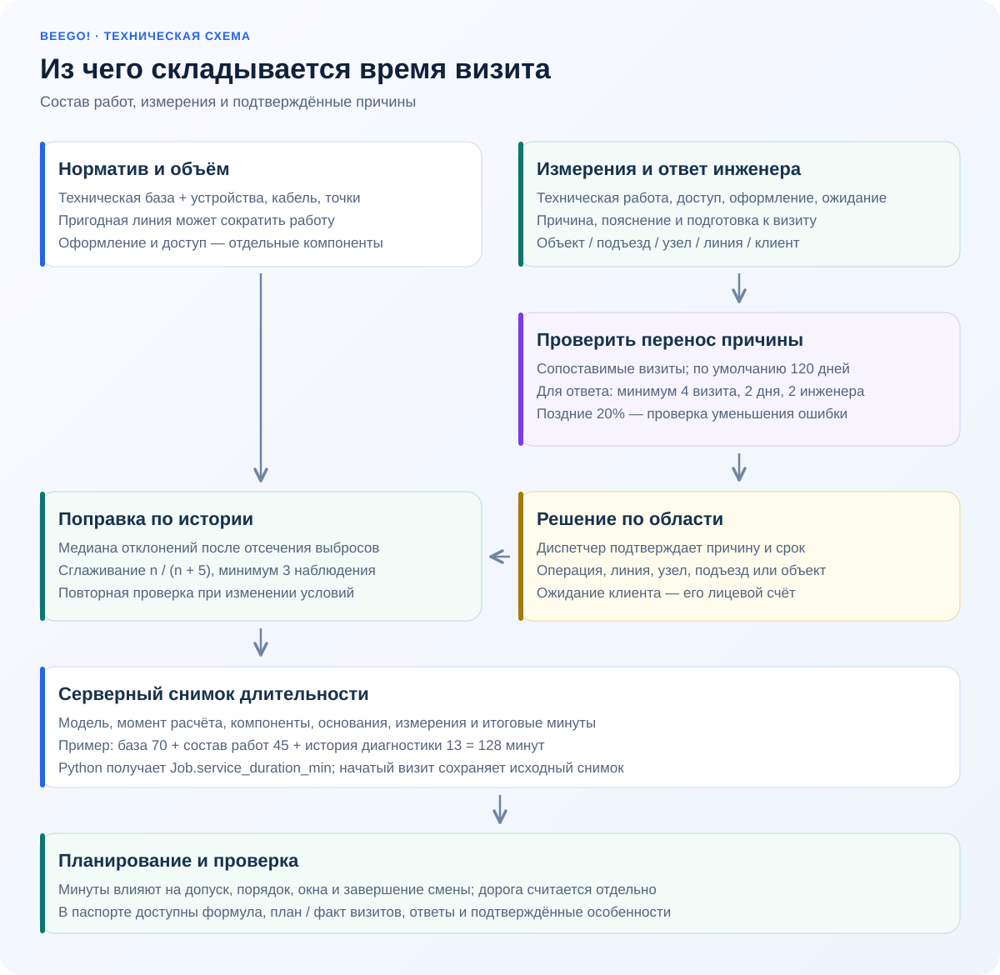

Модель времени подготавливает минуты **до** поиска. Ответ инженера проходит проверку повторяемости и области применения, а подтверждённые измерения уточняют будущую оценку. Снимок с основаниями поступает в Python и сохраняется вместе с планом; его можно проверить в паспорте. [Длительность и обратная связь](docs/features/work-duration.md) описывают формулу и правила переноса причин.

### 9.5. Улучшение первичного плана

После базового назначения [конвейер нового набора](algorithm/tools/run_new_dataset_pipeline.py) может выполнить несколько этапов в пределах бюджета расчёта:

| Этап | Назначение |
| --- | --- |
| Стартовый VRPTW-кандидат | Даёт CP-SAT начальный порядок по поисковой модели, если такой кандидат удалось найти. |
| Уточнение и точная материализация | Проверяет поездки по времени отправления; при конфликте корректирует поисковый граф. |
| Прямые вставки, цепочки и LNS | Пытается назначить оставшиеся заявки и улучшить маршруты с повторной точной проверкой. |
| Сокращение числа бригад | Переносит работы между маршрутами только после проверки нового полного плана. |
| Уточнение времени выезда | Сдвигает ожидание перед поездкой только с повторным расчётом изменённого участка. |

Этапы улучшения выполняются в пределах заданного бюджета расчёта. Итоговый план проходит независимую проверку перед публикацией.

<a id="routing"></a>
## 10. Дорожные данные и расписания

| Движение | Рабочий источник | Как проверяется время |
| --- | --- | --- |
| Автомобиль, велосипед, пеший путь | Локальная Valhalla на OpenStreetMap | Путь по сети, длительность, расстояние и геометрия. |
| Автобус и трамвай | GTFS | Календарь, остановки и конкретное отправление. |
| МЦК и МЦД | Сохранённые ответы Яндекс Расписаний | Отправления эталонного дня недели. |
| Метро | Схема перегонов, входов и пересадок | Явное ожидание **180 секунд при посадке**; полного расписания поездов нет. |

Пешие подходы к станциям считаются по уличной сети. В общей транспортной сети возможны пересадки между наземными маршрутами, метро, МЦК и МЦД; для короткого плеча сравнивается и прямой пеший путь. Время и геометрия наземных и рельсовых участков имеют разное происхождение; схематичная линия на карте обозначается отдельно от точной траектории рельсов.

Операционные ограничения накладываются поверх этой сети на свой срок действия. Закрытие дороги для автомобилей не запрещает пеший проход, если он разрешён; закрытый вход метро отличается от остановки движения поездов и закрытия пересадки. На следующую смену переносится весь действующий интервал, включая окончание на следующий день. Известное открытие может потребовать ожидания перед входом; аудит проверяет фактическое время входа после ожидания, а не момент подхода к станции.

**Схема · статичная иллюстрация**

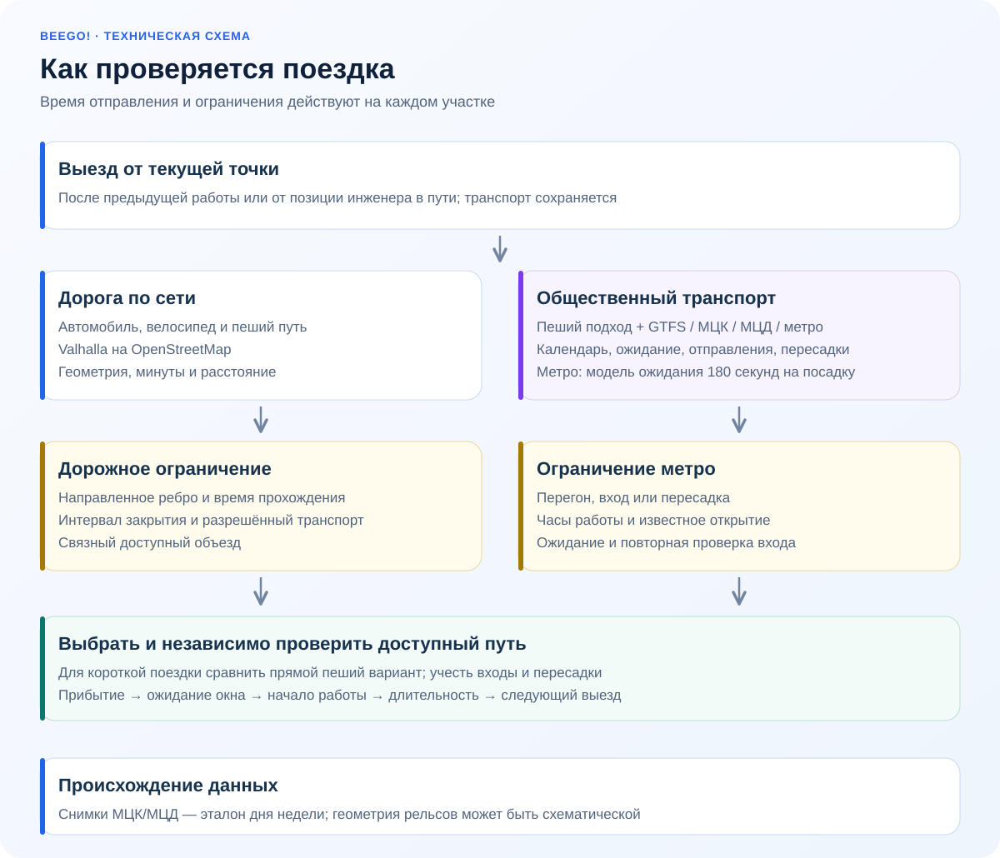

**Почему локальная Valhalla.** Многократный перебор матриц и проверка тысяч участков требуют предсказуемой стоимости. Локальный стек даёт воспроизводимость на одной VM: сетевые пути OSM, доступные отправления GTFS/МЦК/МЦД, пересадки и расчёт по времени выезда. Детальная проверка подтверждает выбранную последовательность поездок.

**Что дало бы подключение 2ГИС в реальном продукте.** [Routing API](https://docs.2gis.com/en/api/navigation/routing/overview) и [Distance Matrix API](https://docs.2gis.com/en/api/navigation/distance-matrix/start) позволили бы получать актуальнее дорожные времена, учитывать пробки и опираться на поддерживаемые провайдером транспортные данные. Это улучшило бы ETA и уменьшило нашу нагрузку по обновлению карт и расписаний. Подписка и лимиты запросов потребовали бы отдельной экономической модели и кэширования. Даже с 2ГИС BeeGo! по-прежнему обязан проверять навыки, оснащение, клиентские окна, общий ресурс и всю смену.

**Недельный эталон МЦК/МЦД.** В [репозитории лежит проверяемый комплект](data/transit/weekly-rail-snapshots-2026-09-29.zip); установщик сверяет размер и SHA-256. Для сценарного дня выбирается снимок **того же дня недели** - эталон типового графика. Обновление учитывает отмены, ремонт и сезонные изменения. Установка и состав источников описаны в [документации данных](docs/reference/data.md).

Geoapify решает **другую** задачу: предлагает адреса и координаты при импорте и ручном вводе. Ключ поиска хранится на сервере; он не меняет провайдера детального дорожного расчёта. Для явного выбора Geoapify как отдельного дорожного провайдера предусмотрен отдельный `GEOAPIFY_ROUTING_API_KEY`.

<a id="events"></a>
## 11. События и публикация плана

**Схема · статичная иллюстрация**

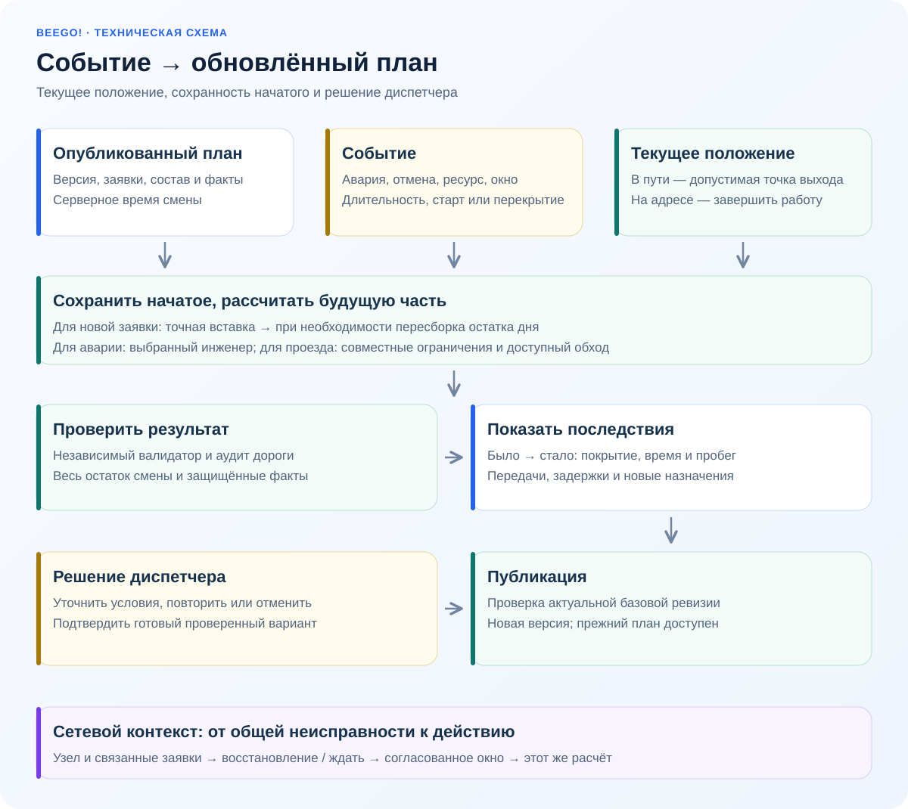

Событие задаёт время, тип, причину и затронутые заявки или бригады. Планировщик сохраняет начатые и завершённые визиты, пересчитывает будущую часть дня и возвращает проверенный черновик. Диспетчер сравнивает результат и публикует новую версию. Выбранный прежний вариант можно восстановить через историю плана.

Для новой заявки поиск начинает с **опубликованного плана** и проверяет вставку в будущие маршруты с реальной дорогой. При необходимости собирается остаток дня заново, начиная с новой заявки и сохраняя начатую работу. Аварийный перехват использует текущее положение инженера на маршруте. Результат проходит независимый валидатор.

При закрытии дороги проверяются направленное ребро и время его прохождения. При закрытии метро - перегон, вход либо пересадка с учётом ожидания и известного открытия. Независимый аудит повторно проверяет выбранный путь. Оператор видит событие, прогресс и готовые варианты решения.

На демонстрационном сервере тяжёлые расчёты выполняются последовательно в одном процессе API; просмотр сайта доступен остальным пользователям. Масштабирование расчётной очереди описано в [операционной документации](docs/operations/deployment.md).

<a id="analytics-data"></a>
## 12. Данные аналитики

**Схема · статичная иллюстрация**

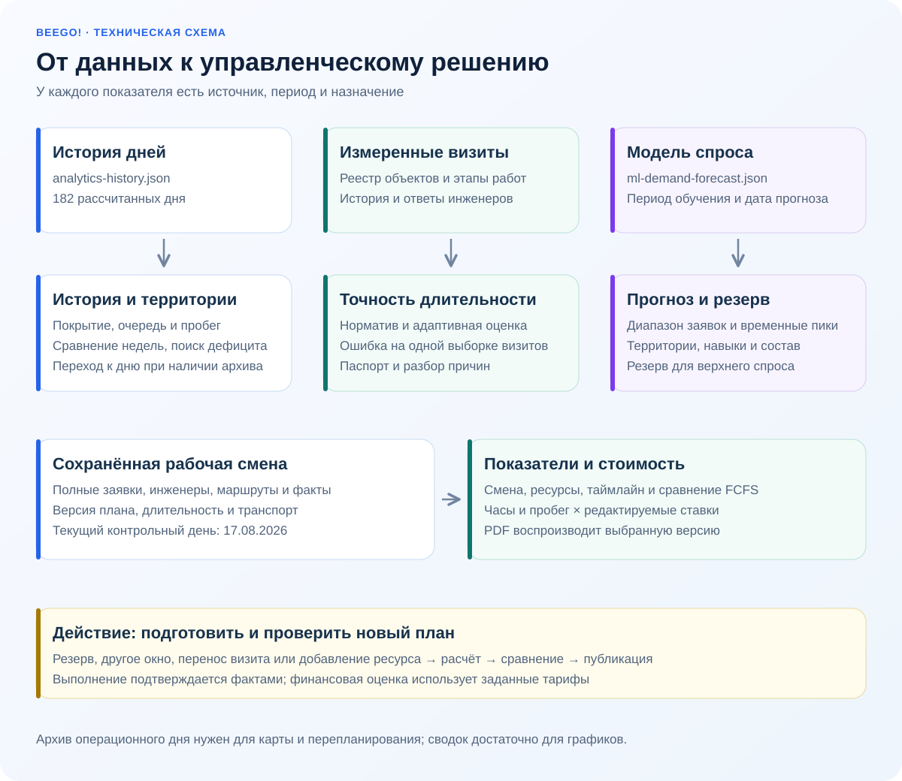

История в `site/public/data/analytics-history.json` содержит **182 рассчитанных синтетических дня**. На этом наборе показаны динамика нагрузки, сравнение периодов и прогноз спроса. Покрытие относится к сохранённому плану, выполнение - к подтверждённым отметкам, финансовые показатели рассчитываются по выбранным ставкам.

Для рейтинга, длительности и сетевых событий доступны источники и основания: завершённый визит и отзыв клиента, измеренное время и подтверждённая причина, узел и связанные заявки. Это позволяет перейти от сводного показателя к конкретным данным.

Графики загружают компактные сводки рассчитанных дней. Для открытия дня на карте и перепланирования используется полный набор заявок, инженеров и маршрутов. Состав комплектов и форматы перечислены в [каталоге данных](docs/reference/data.md).

<a id="docker-start"></a>
## 13. Быстрый старт через Docker

Для полного запуска нужны Git, Docker с Compose и свободный порт `8787`. В уже полученном репозитории выполните из корня:

```bash
docker compose -f compose.complete.yaml up --build -d
docker compose -f compose.complete.yaml ps
```

Откройте **http://127.0.0.1:8787/**. Готовность полного комплекта подтверждают `runtime-setup: exited (0)`, `app/valhalla: healthy` и `ready: true` в **http://127.0.0.1:8787/api/runtime/readiness**. Первый холодный расчёт может занимать несколько минут.

Дорожный граф и исходники транспортного индекса входят в проверяемый комплект; установщик сверяет размеры и SHA-256 и раскладывает их в Linux volumes. [Полная инструкция](docs/operations/quickstart.md) описывает проверку кандидатов и принятия решения, обновление, сохранение данных и диагностику. Контрольный сценарий работает без внешних ключей; AI и произвольный поиск адреса требуют собственных ключей. Рабочие SQLite, секреты и пользовательская история прежнего устройства в Git не включаются. Для переноса сохранённых рабочих дней нужна отдельная согласованная резервная копия; для полного открытия старых модельных дней - их операционный архив.

<a id="deployment"></a>
## 14. Развёртывание и проверка стенда

Текущий стенд работает на Ubuntu 24.04: **4 vCPU, 8 ГБ RAM, диск 120 ГБ**. Nginx принимает внешние запросы, приложение и Valhalla запущены через Docker Compose. Python и транспортный индекс доступны расчётному процессу в том же комплекте. Обновление образов и сохранение данных описаны в [руководстве стенда](deploy/README_RU.md).

Код лежит в версиях `/opt/beego/releases/<commit>`, активный релиз выбирается ссылкой `/opt/beego/current`. SQLite и транспортные данные размещены вне сменяемого каталога кода. Это позволяет откатить приложение без подмены плана и не потерять данные при обновлении. Резервная копия SQLite создаётся согласованно; восстановление требует проверки ревизий и фактов. Конкретные команды - в [руководстве стенда](deploy/README_RU.md).

Интеграция проверялась на тестовой базе по полному циклу **«импорт → план → событие → черновик → публикация → отчёт»**. Проверки включают сохранение назначений, длительность по объектам, разбор отзывов, сетевые зависимости, транспортные ограничения и аварийный выезд.

| Проверка | Что подтверждает |
| --- | --- |
| `pnpm run build` в `site/` | Клиент и серверные модули собираются из текущего кода. |
| `pnpm run test:algorithm` | Контракт точного планирования и валидации. |
| `node --test tests/*.test.mjs` в `site/` | Операционные API, длительность, рейтинг, сетевой контекст, транспорт, импорт, PDF и регрессии интерфейса. |
| `PYTHONPATH=algorithm/src:algorithm/tools:. python -m pytest algorithm/tests --ignore=algorithm/tests/test_traffic4cast.py` | Основной Python-набор: алгоритмы, сохранение начатых работ, транспортные ограничения и независимая валидация. Отдельный Traffic4Cast-набор требует необязательного `h5py`. |
| `pnpm run test:sites` | Контракт поставки через worker; это отдельная проверка, а не замена общего набора. |
| `GET /api/health` и `GET /api/runtime/readiness` | API отвечает, необходимые ресурсы точного расчёта доступны. |
| Проверка в браузере на отдельной SQLite | Разделы присутствуют; новые решения сохраняются; реальная публикация и сравнение маршрутов работают, исходная смена остаётся на месте. |

Результаты общей проверки и контрольные показатели - в [описании проверки платформы](docs/development/validation.md). **35 записей** сняты с работающей версии в **1920×1080** и сохранены в WebP с частотой **25 кадров/с**. В сценариях видны действия и их результат; длительные ожидания расчёта сокращены.

Настройка домена и HTTPS, доступа с ролями, мониторинга, резервного копирования и обновления карт описана в [операционной документации](docs/operations/deployment.md).

---

**Продолжить:** [форматы и источники данных](docs/reference/data.md) · [модель планирования](docs/reference/planning.md) · [пользовательские сценарии](docs/reference/product.md) · [развёртывание и восстановление](docs/operations/deployment.md)
