# BeeGo! — планирование выездных бригад

**От адреса заявки до опубликованного плана смены, который диспетчер может проверить и изменить.**

Мы сделали этот README рассказом о принятых решениях: что видно в продукте, как это обеспечено алгоритмом и почему компоненты устроены именно так. Команды, форматы данных и процедуры развёртывания вынесены в [техническую документацию](docs/README.md).

Теперь тот же рабочий день связывает **качество исполнителя, время на объекте и изменения в пути**: рейтинг помогает подобрать состав, особенности объекта меняют длительность визита, а авария или закрытая дорога требуют нового проверенного решения. Сетевые события показывают, какие заявки зависят от общей неисправности. Во всех этих сценариях сохраняются исходный план, факты и история решений.

<a id="screencast"></a>
## Скринкаст

Рекомендуем начать со скринкаста: он показывает импорт заявок, построение маршрутов, работу со сменой, перепланирование и отчёт. Новые сценарии рейтинга, объектов, аварий и транспортных ограничений показаны ниже на актуальных экранах приложения.

**[Смотреть скринкаст BeeGo](https://drive.google.com/drive/folders/16-bI1dDMEf5oGwzf21izeyWvwMPiTzwm?usp=sharing)**

**[Открыть стенд](http://84.252.135.110/)** · **[Документация](docs/README.md)** · **[Проверка соответствия требованиям](docs/reference/task-requirements.md)**

## Структура репозитория

| Каталог | Содержание |
| --- | --- |
| `site/` | Интерфейс, Node API, публичные примеры и JS-тесты |
| `algorithm/` | Python-планировщик, маршрутизация и регрессионные тесты |
| `data/` | Входы, первичные источники, тестовые примеры и полный runtime-комплект |
| `runtime/`, `tools/` | Запуск маршрутизатора и установка проверяемых ресурсов |
| `deploy/` | Поставка на VM, Nginx и systemd |
| `docs/` | Возможности, эксплуатация, техническая справка и актуальные экраны |

[Запуск](docs/operations/quickstart.md) · [Разработка и тесты](docs/development/contributing.md) · [Каталог данных](docs/reference/data-catalog.md) · [Область применения](docs/reference/limitations.md)

## Содержание

| Продукт | Техническая часть |
| --- | --- |
| [01. Карта и рабочее пространство](#workspace) | [08. Архитектура](#architecture) |
| [02. Импорт данных и поиск адреса](#input) | [09. Алгоритм и проверка ограничений](#algorithm) |
| [03. Инженеры и состав смены](#engineers) | [10. Дорожные данные и расписания](#routing) |
| [04. Ход смены](#shift) | [11. События и публикация плана](#events) |
| [05. Перепланирование](#replanning) | [12. Данные аналитики](#analytics-data) |
| [06. Аналитика](#analytics) | [13. Быстрый старт через Docker](#docker-start) |
| [07. Отчёт, AI-помощник и справка](#report) | [14. Развёртывание и проверка стенда](#deployment) |
| [Скринкаст и стенд](#screencast) | [Лицензии компонентов и данных](THIRD_PARTY_LICENSES.md) |

**Новые сценарии:** [Рейтинг и подбор состава](#rating) · [Время и паспорт объекта](#object-time) · [Сетевые события](#network) · [Домашний старт и аварии](#emergency) · [Дороги и метро](#transport)

---

<a id="workspace"></a>
## 01. Карта и рабочее пространство


На карте видны точки и маршруты, в левой панели — точные сведения о заявках и бригадах. Нажатие на маршрут связывает геометрию с порядком визитов, временем и составом работ. Мы сохранили карту как рабочий контекст во всех основных разделах: при переходе к смене, аналитике или отчёту диспетчер не теряет день, с которым работает.

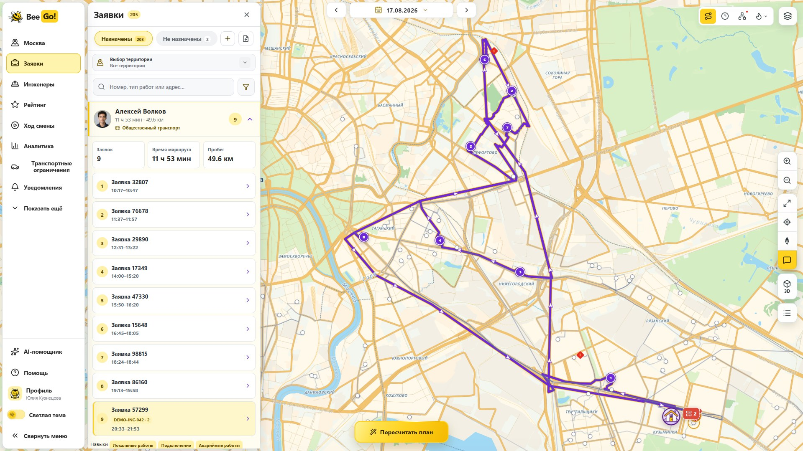

На карте доступны:

- **Заявки и бригады.** Показаны адреса заявок, стартовые точки бригад и маршруты по дорожной сети. Значки различают аварийные заявки, назначенные и оставшиеся в очереди; в выбранном маршруте видны порядок остановок и направление движения.
- **Подробности по нажатию.** Карточка заявки показывает адрес, клиентское окно, вид и норматив работы, оборудование, приоритет, запланированное время прибытия и бригаду. Для заявки в очереди доступны причина и проверка подходящих бригад. Из стартовой точки можно открыть маршрут конкретной бригады.
- **Выбор области и маршрута.** Поиск и фильтры в списке обновляют точки на карте; можно выбрать зону или район, выделить маршрут и приблизить карту к заявке или всем видимым точкам. Легенда объясняет обозначения и позволяет переключать режим выделения маршрута и цвета бригад, когда маршрутов не больше восьми.
- **Просмотр смены.** Карта показывает положение бригад и пройденную часть маршрута на выбранный момент времени; запланированное завершение и фактическая отметка имеют разные обозначения.
- **Выбор точки для новой заявки.** При ручном добавлении или перепланировании координаты можно указать нажатием на карте; выбранная точка отображается маркером.
- **Управление отображением.** Доступны масштаб, возврат ориентации на север, светлая и тёмная темы, 3D-здания, включение подсказок и показ текущего местоположения с разрешения браузера.

<a id="object-time"></a>
### Время на объектах

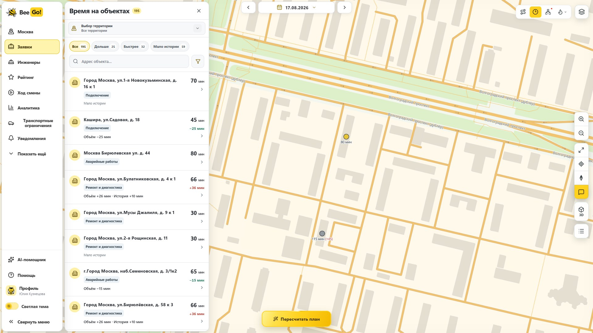

Два одинаковых вида работ могут занять разное время. В одном доме нужно подняться к оборудованию, в другом — проложить дополнительный кабель, в третьем уже есть пригодная линия. Поэтому норматив стал **основой расчёта**, а в план попадает время конкретного визита. Режим времени на карте показывает итоговые минуты и изменение относительно базы; фильтры отделяют длительные визиты от объектов, по которым ещё недостаточно наблюдений. Тепловая карта доступа использует подтверждённые задержки доступа, а не просто большую трудоёмкость заявки.

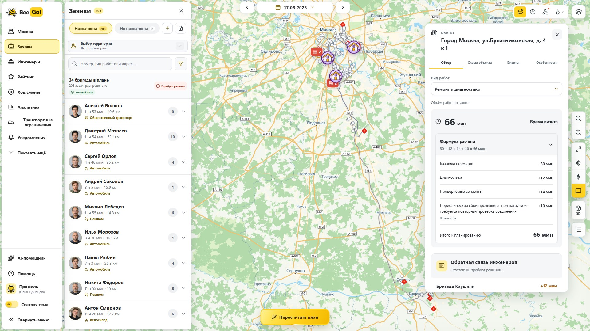

Расчёт разделяет техническую работу, оформление и доступ. Дополнительные устройства, площадки, кабельные работы, состояние линии и подтверждённые особенности меняют соответствующую часть. Этажность и внутреннее устройство здания могут объяснять условия работы, но сами по себе не доказывают задержку. Оформление не умножается на коэффициент технической сложности; дорога считается отдельно. Например, стандартное подключение даёт **60 + 10 = 70 минут**, а тот же вид работ с четырьмя устройствами, тремя площадками и большим объёмом кабеля — **145 + 10 = 155 минут**.

Под формулой видны основания и обратная связь инженеров. Разовое ожидание клиента или произвольный комментарий не превращаются автоматически в постоянную надбавку всему дому. Для переноса опыта нужны сопоставимые измеренные визиты, проверенная область действия и решение по доказательствам. Поправка может как увеличивать, так и уменьшать время. Ручное изменение остаётся отдельным действием с причиной и проверкой будущего плана.

### Паспорт и схема здания


Паспорт связывает оценку времени с объектом: **«Обзор / Схема объекта / Визиты / Особенности»**. Здесь можно проверить состав расчёта, историю посещений, оборудование, сообщения инженеров и условия доступа. Архивный план показан отдельно от измеренного выполнения: сохранённое время назначения ещё не является фактом визита.

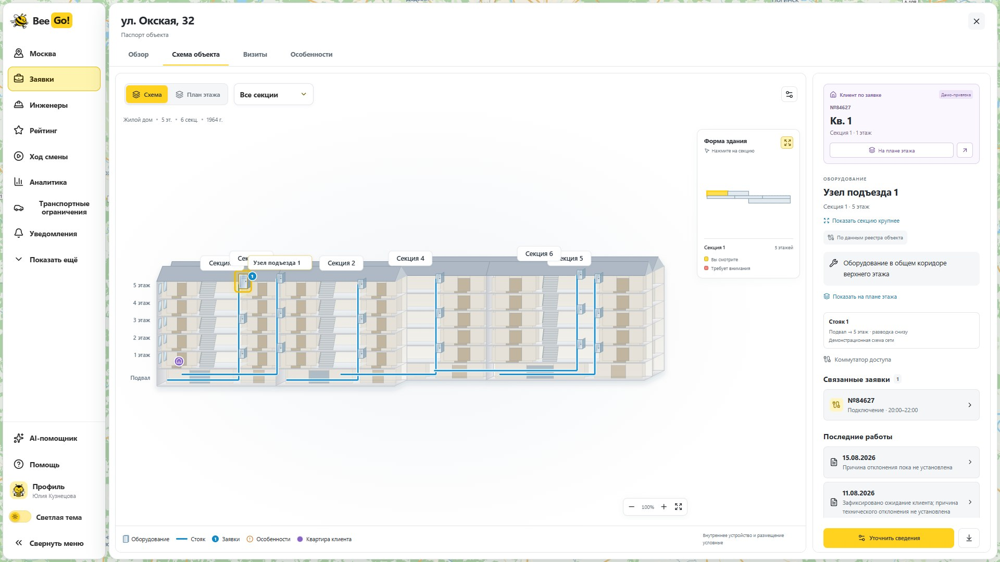

Схема раскрывается на рабочую область, оставляя навигацию доступной. Можно выбрать секцию, перейти на этаж, найти шкаф, стояк и явно связанную квартиру клиента. Это помогает понять место работы и открыть нужную заявку. Контур и доступные параметры здания опираются на реестр/OSM; внутренние помещения, оборудование и кабели в учебном наборе заданы моделью. Карта не выдаёт такие данные за обследованную инфраструктуру. Импортированные и подтверждённые оператором связи сохраняются со своим происхождением.

<a id="network"></a>
### Сеть: влияние на заявки

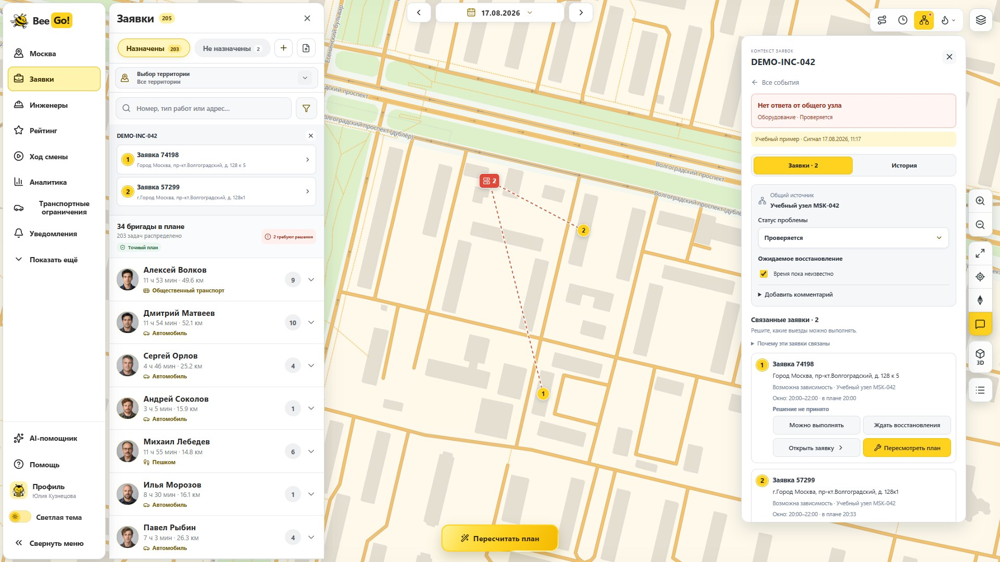

Несколько выездов могут зависеть от одного узла, линии или питания. Обычная карта показывает источник и предупреждения у связанных заявок; режим **«Сеть»** приглушает остальную обстановку и выделяет конкретные зависимости. Номера в карточке совпадают с номерами на карте. Пунктир означает связь заявки с событием, а не физическую кабельную трассу и не маршрут инженера. Связи задаются явными ID и основанием — близость адресов не считается доказательством.

В карточке диспетчер отмечает «Проверяется / Подтверждена / Устранена», ожидаемое восстановление либо неизвестный срок и решение по каждому выезду: **«Можно выполнять / Ждать восстановления»**. История записывает действия автоматически. Эти отметки помогают разобраться в ситуации; они не отменяют заявки и не меняют расписание без подтверждения. «Пересмотреть план» открывает существующий сценарий переноса окна нужной заявки, защищая уже сохранённый черновик.

Живой мониторинг сети не подключён. Три учебных узла на исходном наборе 17.08.2026 явно обозначены внутри карточек; на произвольный импорт фиктивные неисправности не добавляются. Зарегистрированные события, решения и история хранятся отдельно от операционного плана.

<a id="input"></a>
## 02. Импорт данных и поиск адреса

Заявки и состав инженеров принимаются из CSV/JSON; XLS/XLSX доступны через экран импорта. Сопоставление столбцов, проверка обязательных полей и предпросмотр строк происходят **до** расчёта. Координаты из источника сохраняются; для текстового адреса используется серверный Geoapify.

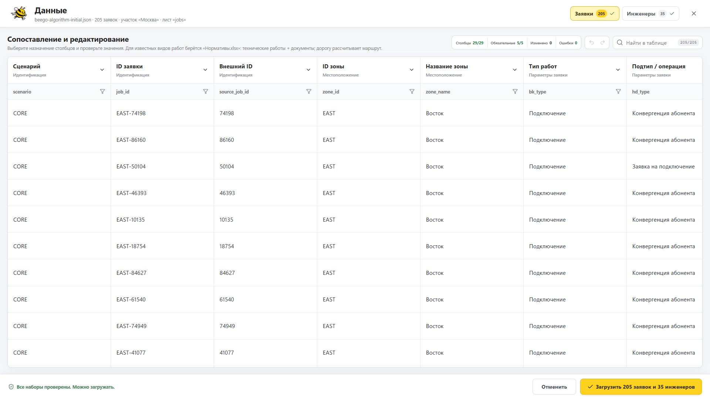

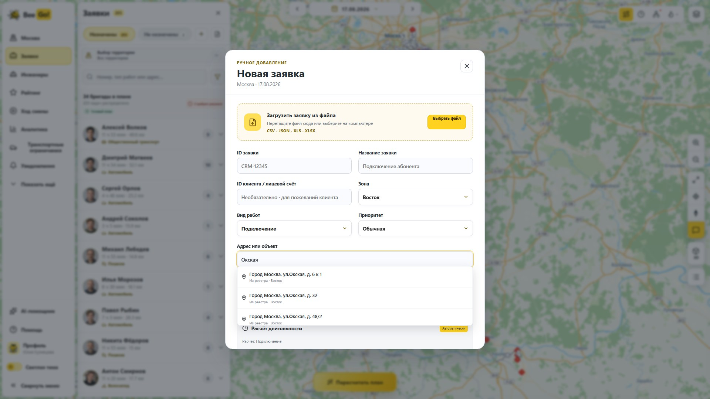

Ручная заявка проходит тот же путь: адрес можно выбрать из реестра объектов, внешней подсказки или указать на карте, затем задать работу, приоритет, окно и оборудование. Она становится входом для **черновика** перепланирования, а не незаметным изменением уже опубликованного маршрута.

Импорт поддерживает также факторы длительности и ссылки на объект, подъезд, узел и линию. Сервер проверяет территорию и рассчитывает время по виду и составу работ. Снимок расчёта связывает исходные факторы, версию модели и итоговые минуты с конкретной опубликованной заявкой; изменение модели не переписывает прежние планы.

<a id="engineers"></a>
## 03. Инженеры и состав смены

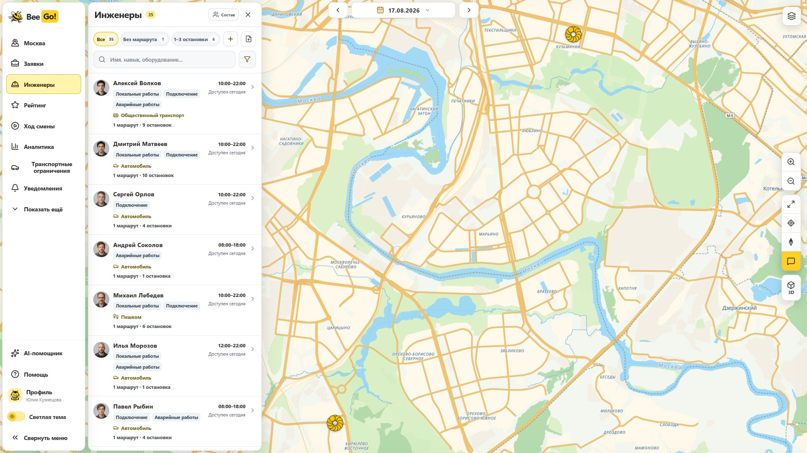

В реестре видны доступность, зона, навыки, транспорт и оборудование. Карточка раскрывает назначенные остановки и загрузку конкретного инженера; отдельный состав смены позволяет добавить резерв или вывести человека из работы через событие.

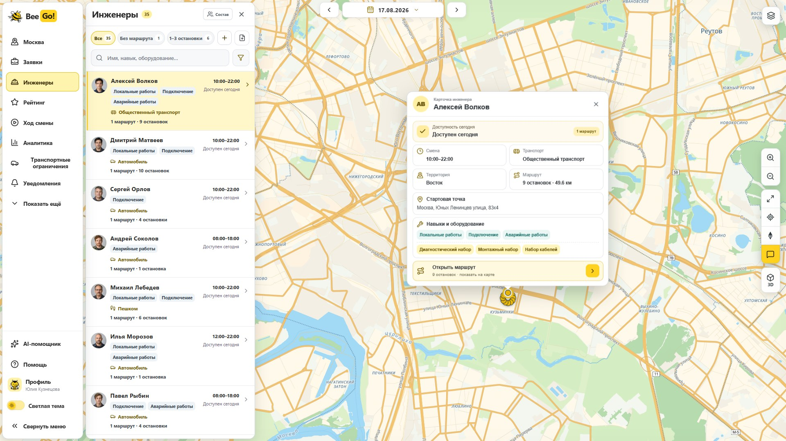

Допуск и оснащение бригады определяют, можно ли назначить ей заявку. Алгоритм отсекает несовместимые пары до вычислительно затратного поиска, а интерфейс показывает причину исключения.

<a id="rating"></a>
### Рейтинг по завершённым визитам

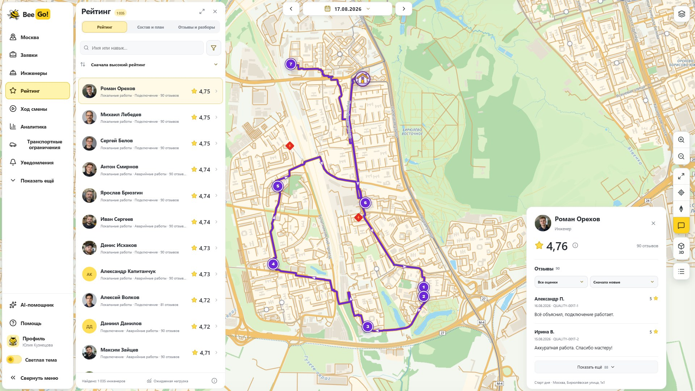

Отзыв относится к **специалисту, выполнившему работу**. Для операционного визита сервер берёт исполнителя из версии плана, действовавшей при подтверждении выполнения; переданный клиентом ID другого инженера не меняет эту связь. Нельзя оценить незавершённый визит или создать второй отзыв на тот же визит. В карточке доступны исходные звёзды, текст клиента, адрес и дата работы, число оценок и распределение по звёздам.

Мы используем сглаженную оценку: `(сумма учитываемых звёзд + 20 × 4,20) / (число отзывов + 20)`. Несколько первых пятёрок не ставят новичка без истории заведомо выше устойчиво хорошего специалиста. Средняя оценка и число отзывов показаны рядом, а формула раскрывается отдельно.

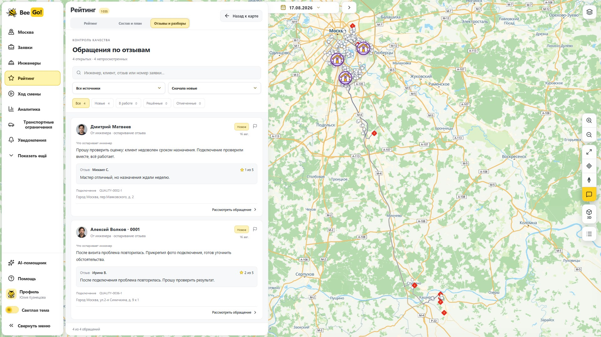

Спорный отзыв можно разобрать с сохранением переписки и версий решения. Исключение из расчёта не удаляет исходные звёзды; изменение оценки требует подтверждения клиента и основания. Пожелание снова пригласить специалиста и отказ после негативного опыта относятся к конкретному клиенту/адресу. Это мягкие предпочтения: они не отменяют навыки, оснащение и клиентские окна и не оправдывают потерю заявки. Учебная история качества отделена от настоящих фактов выполнения.

### Состав с приоритетом качества

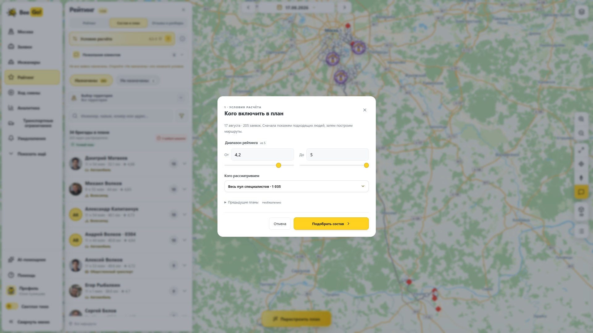

Дополнительный режим рассматривает текущий штат либо **условно неограниченный ресурс через расширенный пул профилей**. Диспетчер задаёт нижнюю и верхнюю границы рейтинга, получает предложение конкретных специалистов и подтверждает его до расчёта маршрутов. Резерв не означает универсального инженера: сохраняются территория, транспорт, смена, стартовая точка, навыки и оборудование соответствующего профиля.


Затем система проверяет полные маршруты и может освободить часть предложенного состава. Результат показывает покрытие и нехватку, а не только среднюю оценку. Для текущего контрольного дня расширенный пул дал допустимый план **203/205 с 34 используемыми специалистами**; две неназначенные заявки остаются видны. Глобальная минимальность состава не доказана, условный либо неполный состав не выдаётся за готовое полное решение. Рейтинговые сценарии и их версии хранятся отдельно и не заменяют рабочую смену.

<a id="shift"></a>
## 04. Ход смены

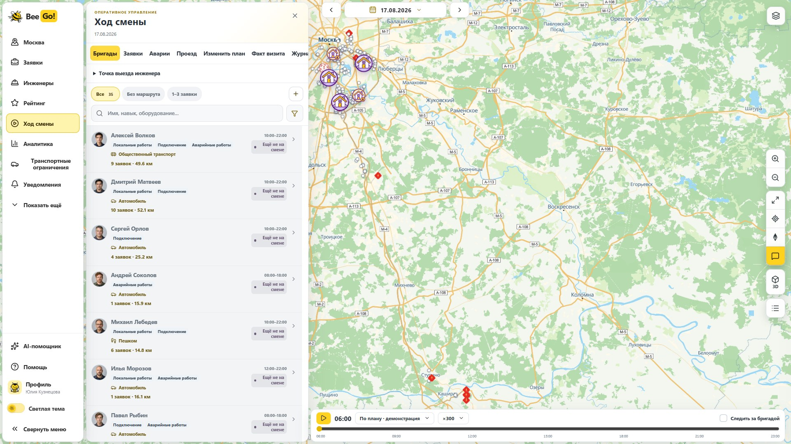

В разделе **Ход смены** доступны маршруты бригад и заявки, шкала времени, события и фактические отметки. Проигрывание времени показывает состояние опубликованного плана в выбранный момент.

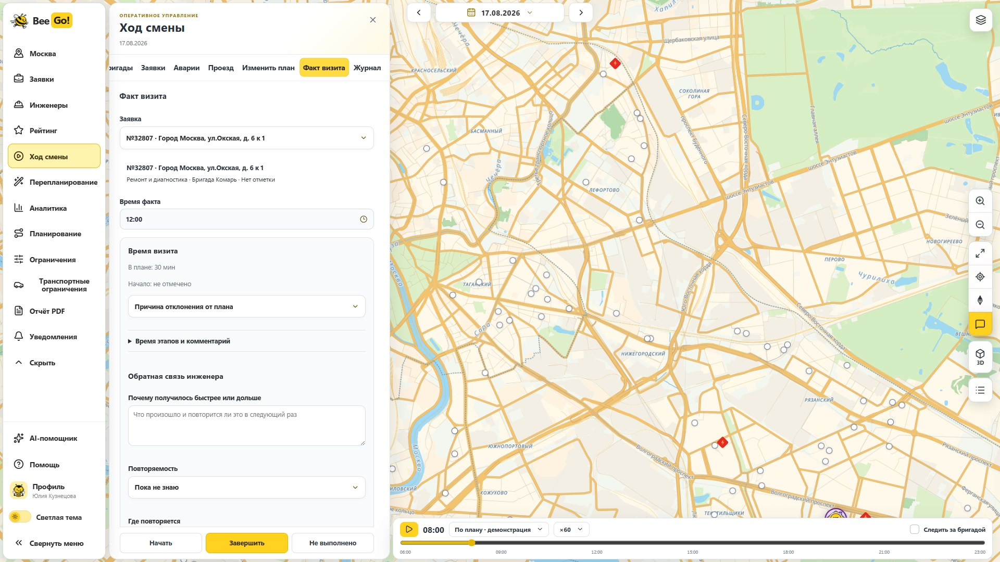

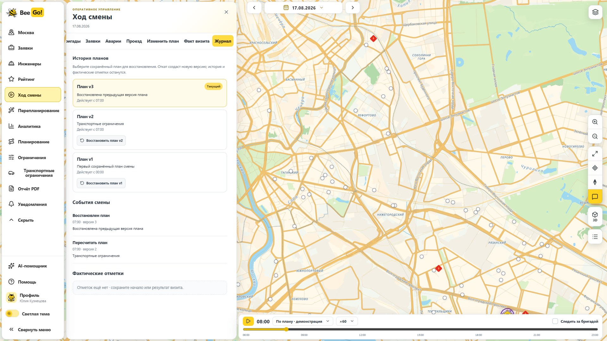

Операционная история сохраняется отдельно от плана. Фактические отметки позволяют после смены отличить ошибку маршрута от отмены клиентом и оценить исполнение независимо от анимации карты.

<a id="emergency"></a>
### Домашний старт и аварийный выезд

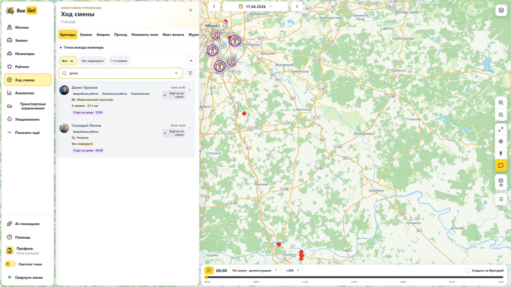

Стартовая точка больше не обязана быть офисом. План учитывает известный домашний адрес инженера, время начала смены и его транспорт. В учебном сценарии два существующих специалиста начинают дома; это сценарные адреса реестра, а не реальные сведения о проживании сотрудников. Для совпадающего исходного набора проверенный домашний старт увеличивает покрытие с **203/205 до 204/205** без изменения навыков и окон. Чужой импорт или уже выполняющаяся смена не подменяются этим примером.

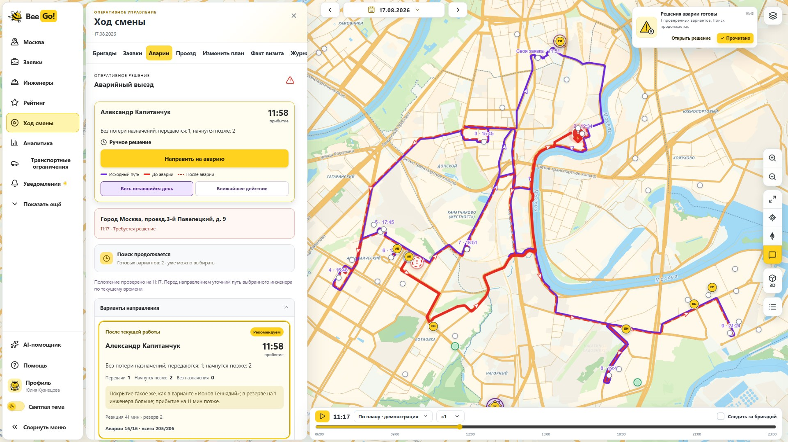

При аварии важна **текущая ситуация**, а не утренняя стартовая точка. Для инженера в дороге система определяет положение на сохранённой геометрии и проверяет перехват от этого места. Если он работает на адресе, сначала сохраняется завершение текущей заявки, затем начинается аварийный выезд. При перехвате прежний адрес назначения может быть передан другому допущенному инженеру; получатель и последствия для остальных работ видны в решении. Домашний резерв рассматривается отдельно, с его реальной доступностью.

Фиолетовая линия показывает оставшийся исходный путь, красная — выезд к аварии и продолжение дня. Карточка соединяет прибытие, назначенного инженера, перенесённые заявки и возможные потери. Поиск отдаёт проверенные предложения по мере готовности; быстрый первый ответ не объявляется доказательством лучшего возможного решения. Выбор человека остаётся у диспетчера. Перед подтверждением устаревший вариант пересчитывается от текущего момента **для выбранного инженера**, с проверкой всей оставшейся смены. Уже выполненное и фактически начатое не исчезает из истории.

<a id="transport"></a>
### Проезд: дороги и метро

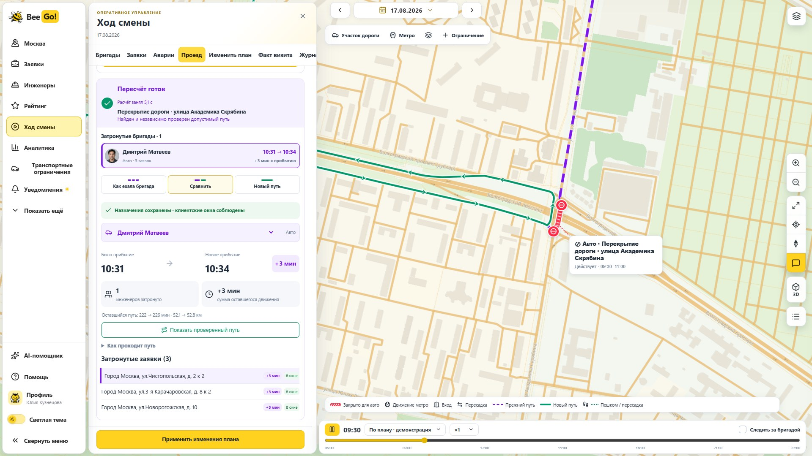

Транспортная проблема появляется на **общей карте смены**, даже если оператор смотрит бригады или заявки. Новое активное событие приближает место проблемы и открывает «Проезд». Нажатие на ограничение показывает затронутых инженеров и заявки, старое и новое время прибытия и сравнение маршрутов: **фиолетовый — прежний, зелёный — проверенный новый**. Система рассчитывает последствия на момент события; применение остаётся отдельным решением.

Оператор может задать время начала, окончание на следующий день либо неизвестный срок. Дорогу выбирают по точкам, перетаскивают границы или рисуют кистью; линия привязывается к существующей дорожной сети. Случайное соседнее ребро, разрыв и большой непрошенный объезд не сохраняются как частичное закрытие. Метро выбирается по настоящим станциям: первый клик выделяет станцию, второй — участок этой ветки с промежуточными станциями. Отдельно поддерживаются движение, вход и пересадка, с разрешённым направлением ограничения.

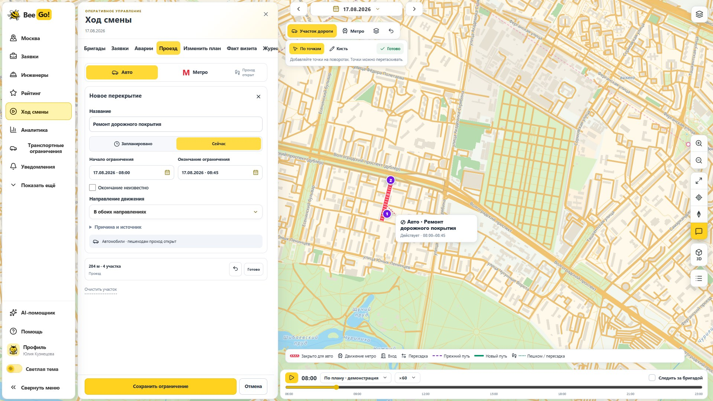

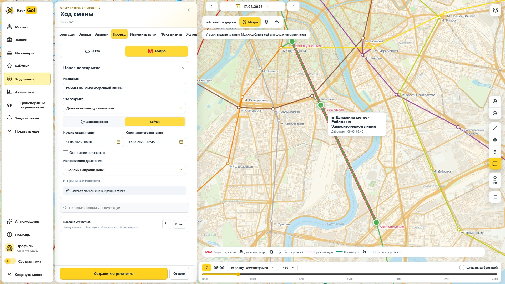

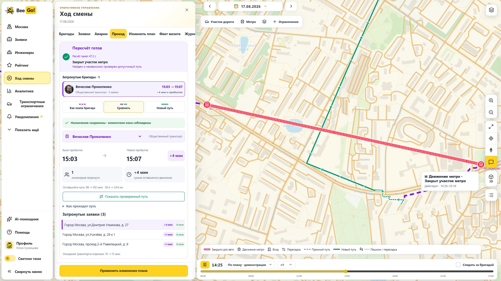

Инженер сохраняет свой транспорт: закрытие метро не превращает его в автомобилиста. Проверяются доступные связи, часы работы, входы, пересадки и ожидание известного открытия. Расчёт показывает настоящий прогресс и измеренное время работы; сбой или отмена не публикуют непроверенный путь. Совместные ограничения учитываются вместе с аварийным выездом.

Воспроизведение при новом решении по умолчанию замедляется до ×1, а выбор скорости всегда доступен. После применения возвращается прежнее ускорение, если оператор не выбрал другое. В учебном прогоне два транспортных события — дорога в **09:30** и метро в **14:25**; авария поступает в **11:17**. Перемотка на **06:00** запускает новый чистый прогон без обновления страницы, сохраняя прошлые запуски и их историю.

<a id="replanning"></a>
## 05. Перепланирование

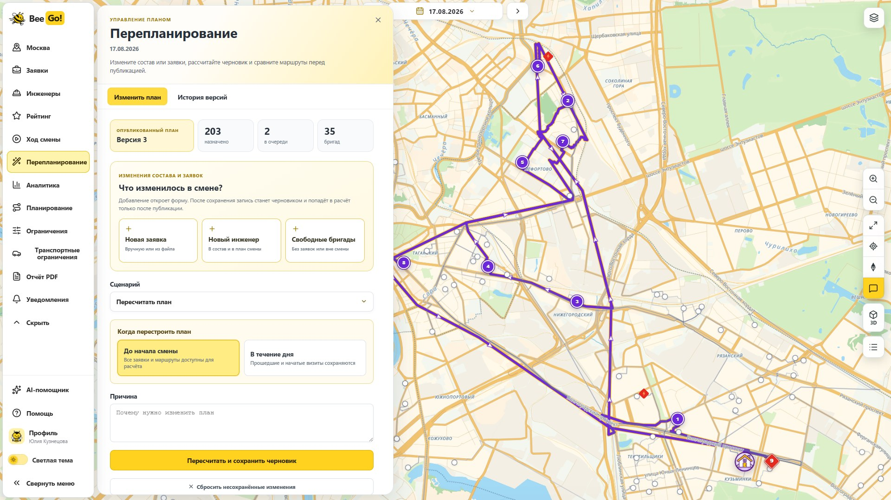

Новая авария, отмена, недоступность инженера, изменение окна или добавление ресурса оформляются как событие. Отмена снимает заявку с будущего маршрута; опубликованный план меняется только после проверки и подтверждения черновика. Для новой заявки планировщик сначала ищет точную вставку в действующие маршруты. Если она не найдена, он заново собирает будущую часть дня, сохраняя уже начатые визиты.

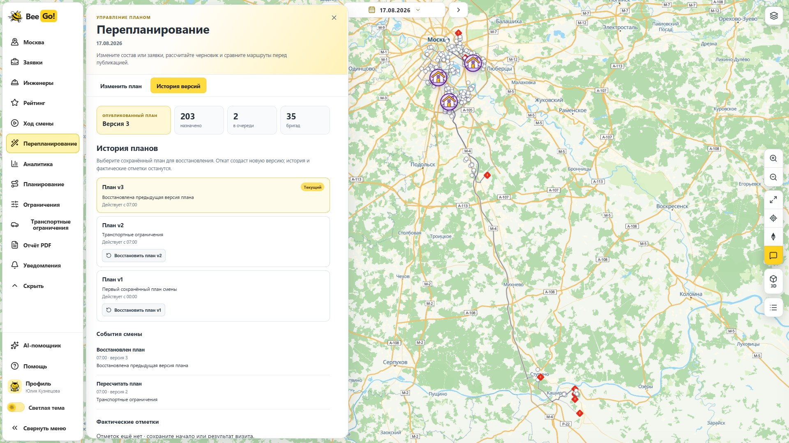

Публикация создаёт новую версию и запись в журнале; прежнюю можно восстановить отдельной новой ревизией. Черновик и опубликованный план хранятся раздельно, поэтому сбой расчёта или закрытие вкладки не переписывает текущую смену.

Диспетчер должен видеть, какое обещание клиенту меняется. Автоматическая замена активного плана после каждого события лишила бы человека возможности проверить последствия и объяснить решение.

<a id="analytics"></a>
## 06. Аналитика

### Смена

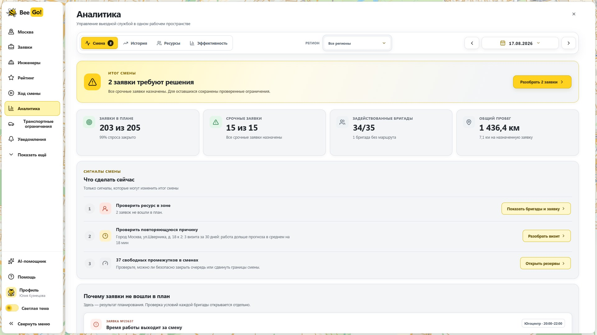

Для контрольного дня **17.08.2026** исходный план после перехода на переменную длительность назначает **203 из 205** заявок, включая **15 из 15 срочных**, задействует **34 из 35** бригад; суммарный маршрут — **1 436,4 км**. Это сохранённый операционный план, отдельно от домашнего и рейтингового сценариев. Одна оставшаяся работа не помещается в смену даже без дороги; для другой проверенные вставки не укладываются в клиентское окно. Сводка соединяет покрытие, очередь, пробег и число бригад, а причину можно открыть для конкретной заявки.

В аналитике есть **бейзлайн FCFS** — распределение в порядке поступления. Его интерфейсная модель использует приближённые расстояния и типовые скорости; основной план учитывает локальные дороги и расписания. Сравнение показывает разницу в покрытии на выбранных входных данных, а расстояния двух моделей следует читать с учётом разных способов расчёта. Прежние цифры полного покрытия на фиксированных нормативах не описывают новый день с изменившейся трудоёмкостью.

| Элемент | Что даёт диспетчеру |
| --- | --- |
| Покрытие, аварии, очередь | Проверить результат по всем заявкам и отдельно по срочным работам. |
| Бейзлайн FCFS | Увидеть, сколько заявок назначает простое правило поступления на тех же входных данных. |
| Зоны и состав смены | Найти территории с нехваткой подходящих бригад и оценить запас ресурсов. |
| Структура времени и рекомендации | Отличить время работы от дороги и простоя; перейти от показателя к конкретному действию. |

### История


История охватывает **182 рассчитанных дня** с 17.02 по 17.08.2026. Фильтр периода, покрытие, очередь и пробег на заявку показывают динамику; сравнение соседних периодов помогает заметить изменение нагрузки до просмотра отдельных смен.

Список дней позволяет открыть дату с необычной очередью. Ниже система формирует объяснения по всей истории: называет повторяющийся дефицит навыка и зоны, число затронутых заявок и дней, затем предлагает действие. Это полезнее общего предупреждения о снижении процента покрытия.

Разрез по территориям связывает покрытие, пробег и очередь с местом возникновения проблемы. Необычные изменения сопоставляются с типичными значениями для аналогичных дней недели, поэтому разовый пик можно отделить от повторяющегося дефицита.

### Прогноз спроса

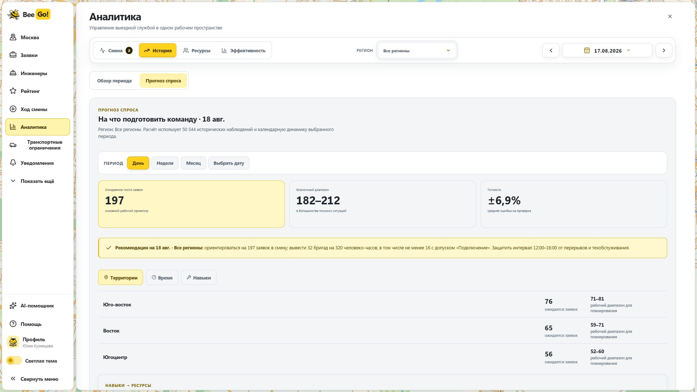

Прогноз показывает ожидаемое число заявок, диапазон и ошибку на истории. Диапазон нужен для решения о резерве: штат, рассчитанный ровно на центральное значение, может не покрыть верхнюю границу спроса. Разрез по навыкам и территориям переводит спрос в оценку состава. Это оценка потребности, а не уже проверенные адресные маршруты или обещание закрыть все окна клиентов.

Разрезы по зонам и навыкам переводят число заявок в состав смены. Почасовой профиль показывает, когда нужен резерв, а пояснение модели раскрывает использованные признаки: календарь, средний спрос и долю работ по подключению.

### Ресурсы


Здесь видны средняя загрузка, свободные часы и бригады без маршрута. Реестр можно фильтровать по зоне, навыку, транспорту и состоянию. Для каждого инженера показаны загрузка, назначенные работы и причина, по которой ему предлагается действие или оставляется резерв.

Временная диаграмма показывает работу, раннее прибытие и свободное окно на общей шкале 08:00–22:00. По ней видно, где именно возникает простой и можно ли рассматривать бригаду для новой заявки; окончательное назначение всё равно проходит расчёт и валидацию.

### Эффективность


Финансовая модель переводит плановые часы и пробег в стоимость по редактируемым ставкам. Видны стоимость смены и заявки, ФОТ, транспорт по видам и сравнение с FCFS. Месячная проекция — расчёт по заданным тарифам, а не измеренная экономия; изменение тарифа сразу показывает чувствительность вывода.

Сравнение видов транспорта показывает пробег, время и стоимость визита. Для длинных маршрутов система называет **ограничивающую заявку** и объясняет, что повлияло на путь: окно клиента, навык, зона или доступный транспорт. Это позволяет обсуждать конкретный маршрут, а не только его общий километраж.

### Точность времени работы


Прогноз трудоёмкости и прогноз спроса решают разные задачи. Здесь фиксированный норматив, адаптивная оценка и доступная обученная модель сравниваются **на одних пригодных завершённых визитах**. Показаны ошибка в минутах, размер выборки и случаи недооценки/переоценки. Неполные измерения и прогнозы, сделанные после начала работы, не становятся доказательством качества. Дополнительные учтённые минуты не называются «предотвращёнными опозданиями»: для такого вывода нужно отдельное сравнение двух проверенных расписаний.

<a id="report"></a>
## 07. Отчёт, AI-помощник и справка

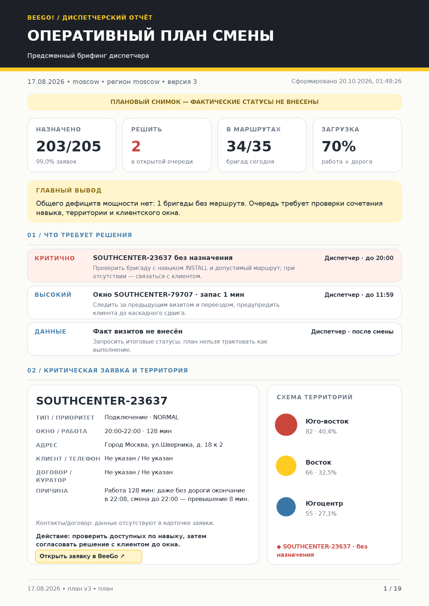

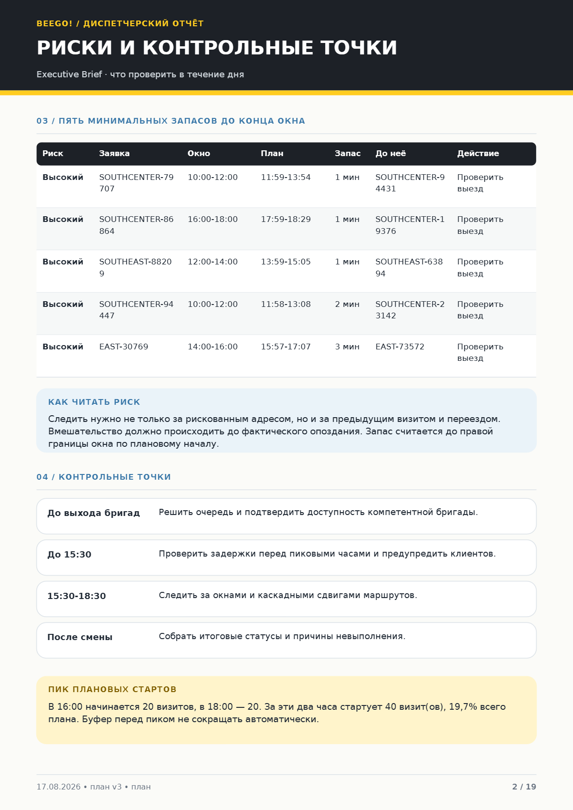

**[Открыть текущий PDF-отчёт за 17.08.2026](docs/assets/beego-report-2026-08-17.pdf)** · 19 страниц.

PDF собирается на сервере из сохранённой ревизии смены: итог, маршруты, очередь, ресурсы, события и факты. Новый выпуск попадает в архив отдельной записью; старый не перезаписывается. Итог и контрольные точки находятся в начале, детализация маршрутов — дальше.

Отчёт включает сохранённые оценки длительности и их основания. Число страниц зависит от состава дня; внутри приложения доступен предпросмотр и скачивание того же PDF. Изменение модели времени после публикации не меняет уже выпущенный документ.

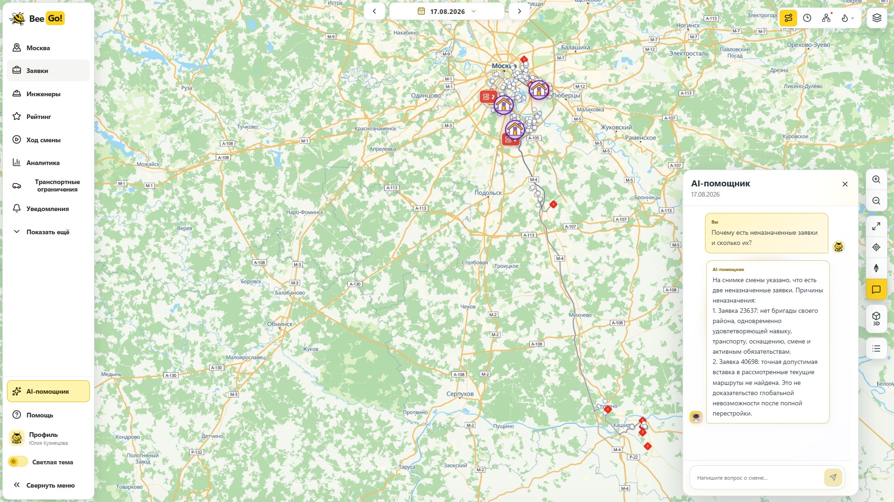

AI-помощник добавлен как необязательная поддержка оператора: если в маршруте, показателе или событии трудно разобраться, можно задать вопрос по выбранной смене. Он получает ограниченный снимок данных и поясняет его; публикацию плана, расчёт и цифры PDF определяют отдельные функции системы. Ключ Yandex AI Studio хранится на сервере.

Уведомления собирают результаты операций и важные события; справка проводит по интерфейсу. Профиль на стенде отвечает за отображаемые данные и оформление, **не является системой аутентификации**. Эта граница видна и в архитектуре доступа.

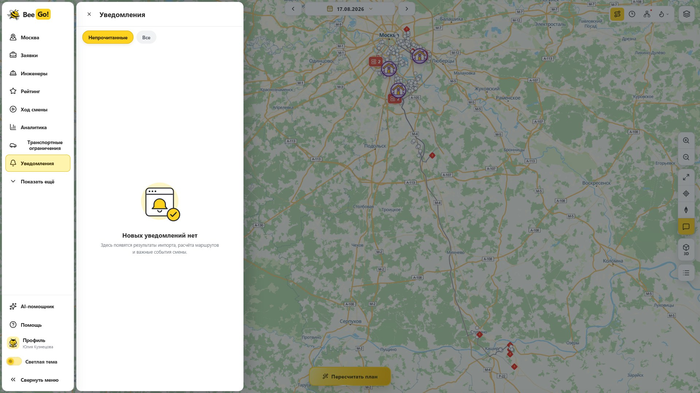

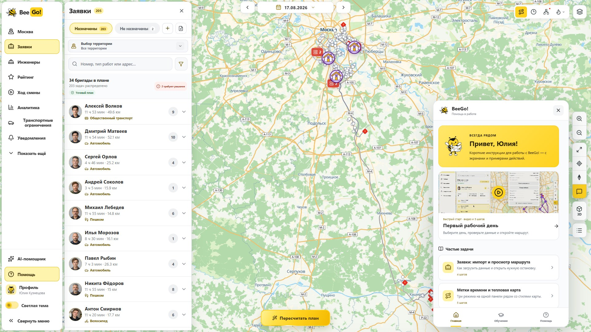

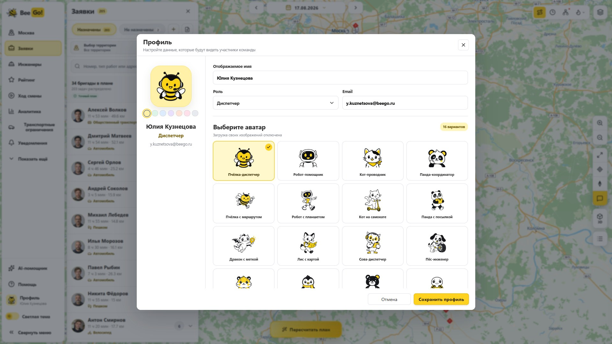

---

<a id="architecture"></a>
## 08. Архитектура


Браузер показывает карту, списки, аналитику и результаты операций. Nginx отдаёт интерфейс и направляет запросы `/api` в **один процесс Node API**. Сервер хранит операционную смену, версии, события и фактические отметки в SQLite; расчёт запускает в Python-процессе и передаёт ему локальные дорожные и транспортные данные. Начальный расчёт и предпросмотр перепланирования занимают один общий вычислительный слот. Остальные пользователи могут просматривать сайт во время расчёта.

Новые функции подключены к тому же приложению и одной постоянной карте. Отдельные контуры хранения не дают отзыву, сетевому комментарию или примерке состава незаметно переписать рабочий день:

| Контур | Что сохраняется | Как влияет на план |
| --- | --- | --- |
| Длительность и паспорт | Версии модели, состав работы, измерения, подтверждённые условия и снимок оценки | Сервер готовит минуты до расчёта; опубликованный снимок остаётся неизменным. |
| Рейтинг | Завершённые визиты, отзывы, решения и отдельные рейтинговые сценарии | Подбор людей и маршрутов выполняется отдельно от операционной смены. |
| Сетевой контекст | Источники, явные зависимости, статусы, решения по выездам и история | Подготовка открывает черновик; сама отметка «ждать» не меняет маршрут. |
| Проезд и аварии | Ограничения сети, проверенные предложения, выбранный инженер и публикации | Новый план требует точного расчёта и проверки всего оставшегося дня. |

Поиск адресов обращается к Geoapify через API. PDF собирается сервером из сохранённой версии; AI-помощник отправляет ограниченный снимок смены в Yandex AI Studio. Эти функции не участвуют в проверке маршрута. Исторические агрегаты аналитики загружаются отдельно от полных операционных смен. Секреты внешних сервисов хранятся на сервере.

| Компонент | Роль и причина выбора |
| --- | --- |
| React/Vite + MapLibre | Быстрый интерактивный обзор карты, списков и временной шкалы без переноса правил допустимости в браузер. |
| Nginx | Отдаёт собранный интерфейс и проксирует API на одной VM. |
| Node API | Принимает действия диспетчера, управляет одним слотом расчёта, проверяет статус результата и публикует версии. |
| SQLite | Хранит черновики, ревизии, журнал, факты и архив отчётов транзакционно; для одного небольшого стенда достаточно одной базы. |
| Python + OR-Tools | Первичный CP-SAT поиск, событийный точный поиск и независимая проверка плана отделены от интерфейса. |
| Valhalla + транспортный индекс | Локальные дороги OSM, GTFS, МЦК/МЦД и метро дают повторяемый расчёт без оплаты каждого массового дорожного запроса. |
| Geoapify | Подсказки адресов и геокодирование; не выбирает дорожный маршрут для проверки плана. |
| PDF и Yandex AI Studio | PDF воспроизводится из сохранённой ревизии; ответы AI не меняют план и расчётные показатели. |

<a id="algorithm"></a>
## 09. Алгоритм и проверка ограничений


Слева показан первичный расчёт: от допустимых пар и поисковых матриц до CP-SAT, детальных поездок и локальной коррекции. Справа — событийный расчёт от **опубликованной версии**. Он сохраняет начатую часть дня; для новой заявки сначала проверяет точную вставку, затем при необходимости перестраивает будущие визиты. Другие события изменяют только допустимую будущую часть. Только завершённый поиск может оставить новую заявку в очереди с причиной; при истечении лимита черновик не публикуется. Оба пути проходят независимый валидатор и контроль статуса на сервере перед сохранением результата.

Для неизменённого контрольного набора API может использовать заранее сохранённый проверенный артефакт; новые входные данные запускают Python-планировщик. Перепланирование не подменяет эту ветку повторным первичным CP-SAT расчётом.

### 9.1. Отбор допустимых пар

Для каждой пары заявки и инженера проверяются создание заявки к моменту расчёта, доступность человека, территория, навык, допустимый транспорт, личное многоразовое оборудование и жёсткое закрепление. Затем проверяется теоретическое пересечение окна начала работы со сменой с учётом норматива. Причины отклонения сохраняются кодами, чтобы необслуженная заявка получала объяснение.

Общее оборудование учитывается как ограниченный ресурс по территории; суммарное назначение не превышает доступное количество. Норматив задаёт базу по виду работы, затем сервер учитывает её состав и подтверждённые условия объекта. В `Job.service_duration_min` попадает итог снимка, а не одно фиксированное число для всех похожих заявок. Дорога рассчитывается отдельно.

### 9.2. Как соблюдаются ограничения ТЗ

Правила включены в модель поиска, а [отдельный валидатор](algorithm/src/beeline_planning/validator.py) повторно проверяет **готовый план по исходным данным и расчётам поездок**. Результат проверки основан на данных и ограничениях; для нарушений возвращаются конкретные коды.

| Правило | Как не допускаем нарушение при поиске | Что независимо проверяется перед публикацией |
| --- | --- | --- |
| Каждая известная заявка имеет ровно один итог | Для заявки CP-SAT задаёт ровно один исход: назначение инженеру либо постановка в очередь. Заявка, созданная позже момента расчёта, ещё не участвует. | Нет дублирования, одновременного назначения и очереди, пропавших и неизвестных заявок (`DUPLICATE_ASSIGNMENT`, `JOB_RESULT_MISSING` и др.). |
| Квалификация и территория | В граф допускаются только доступные инженеры своей зоны с нужным навыком. | Для каждого визита заново сопоставляются инженер, зона, навык и доступность (`ZONE_MISMATCH`, `SKILL_MISSING`, `ENGINEER_UNAVAILABLE`). |
| Транспорт | Требование заявки сопоставляется с режимом инженера до создания пары. | Совпадение разрешённого транспорта и режима фактического дорожного ответа (`TRANSPORT_MISMATCH`, `ROUTE_MODE_MISMATCH`). |
| Личное и общее оборудование | Личный многоразовый комплект проверяется для пары; общий расходуемый запас ограничен суммой назначений по зоне. | Достаточность у инженера и суммарный лимит склада (`PERSONAL_EQUIPMENT_MISSING`, `SHARED_INVENTORY_EXCEEDED`). |
| Окно клиента и смена | Время старта работы — переменная в закрытом клиентском окне; дорога, ожидание и норматив должны уложиться в смену. | Начало не раньше прибытия и внутри окна; окончание работы до конца смены (`SERVICE_BEFORE_ARRIVAL`, `TIME_WINDOW_VIOLATED`, `SHIFT_VIOLATED`). Ранний приезд с ожиданием допустим. |
| Непрерывность маршрута | Дуги образуют последовательность от подтверждённого старта — офиса или дома; при аварии начало остатка определяется текущим положением и занятостью. Ограничены число заявок и длительность маршрута. Возврат в офис для MVP не обязателен. | Каждый участок начинается там, где закончился предыдущий, рассчитан на нужное время отправления; нет перекрытия работ и превышения лимитов (`ROUTE_CHAIN_BROKEN`, `ROUTE_DEPARTURE_MISMATCH`, `MAX_JOBS_EXCEEDED`, `MAX_ROUTE_MINUTES_EXCEEDED`). |
| Доступность дороги | Поисковая оценка только предлагает дугу; итоговая последовательность пересчитывается детальным провайдером. | Недостижимый или неизвестный путь, несоответствие округления минут и необоснованное нулевое время переезда блокируют план (`ROUTE_UNREACHABLE`, `ROUTE_UNKNOWN`, `ROUTE_ROUNDING_INVALID`, `IDENTITY_ROUTE_INVALID`). |
| Аварии и закрепления | При частичном покрытии сначала минимизируется число необслуженных аварий; после покрытия улучшается время реакции. Жёсткое назначение фиксируется в модели. | Аварийность пересчитывается в метриках, а обязательный инженер проверяется кодом `HARD_COMMITMENT_VIOLATED`. Приоритет не разрешает нарушать время, навык или транспорт. |
| Событие в середине смены | Пересчёт получает время события и замороженную прошлую часть маршрута. | Не изменены уже начатые, идущие и завершённые участки; недоступный инженер не получает новую работу до возвращения (`FROZEN_ACTIVITY_CHANGED`, `UNAVAILABLE_AFTER_EVENT`). |

Входные отметки времени должны иметь часовой пояс и целые минуты; валидатор проверяет это отдельно. Если дорожный ответ отсутствует, статус становится `ROUTING_INCOMPLETE` или `INVALID`, а не `VALID`. Необслуженная работа остаётся в очереди с причиной. Аналитика может оценить потребность в дополнительной бригаде, но такая оценка сама по себе **не является новым маршрутом**: добавленный ресурс проходит полноценный пересчёт.

### 9.3. Поиск и проверка допустимости

CP-SAT выбирает назначение и последовательность по графу допустимых переходов. Поисковые матрицы позволяют перебрать много комбинаций на одной VM; для общественного транспорта они могут недооценить ожидание в конкретную минуту. На уровне цели сначала ищется полное покрытие допустимого набора. После покрытия сокращается число занятых бригад, затем время реакции на аварии; следующие уровни улучшают дорогу, ожидание и баланс.

**Почему такой порядок целей.** Пять сэкономленных километров не компенсируют оставленную без обслуживания заявку. Реакция на аварию важна, но не должна незаметно отнимать исполнителя у другой обязательной работы или требовать лишнюю бригаду, когда задача допускает полное покрытие существующим составом.

### 9.4. Проверяем конкретную последовательность

После поиска маршрут каждой бригады рассчитывается последовательно: время отправления на следующий участок зависит от окончания предыдущей работы. Если инженер приехал раньше окна, он может ждать; **начать работу** нужно внутри клиентского окна, закончить — до конца смены. Далее применяются локальные перестановки, переносы и цепочки вытеснений; принятое улучшение снова проходит детальную проверку **всего** плана.

Контроль публикации реализован в двух местах: Python выставляет результат независимой проверки, а [серверное хранилище](site/server/shiftStore.mjs) не принимает план без `EXACT_VALID`, `publicationAllowed=true`, `validation.status=VALID`, `contentSha256` и при наличии признака `approximateTravel`. Эти проверки действуют при начальном расчёте и при публикации событийного черновика. `EXACT_VALID` означает допустимость **в рамках входных данных и транспортной модели**, а не доказательство глобального оптимума или знание будущих пробок.

### 9.5. Улучшение первичного плана

После базового назначения [конвейер нового набора](algorithm/tools/run_new_dataset_pipeline.py) может выполнить несколько этапов в пределах бюджета расчёта:

| Этап | Назначение |
| --- | --- |
| Стартовый VRPTW-кандидат | Даёт CP-SAT начальный порядок по поисковой модели, если такой кандидат удалось найти. |
| Уточнение и точная материализация | Проверяет поездки по времени отправления; при конфликте корректирует поисковый граф. |
| Прямые вставки, цепочки и LNS | Пытается назначить оставшиеся заявки и улучшить маршруты с повторной точной проверкой. |
| Сокращение числа бригад | Переносит работы между маршрутами только после проверки нового полного плана. |
| Уточнение времени выезда | Сдвигает ожидание перед поездкой только с повторным расчётом изменённого участка. |

При ограничении времени отдельные улучшения могут не выполниться. Статус публикации определяется проверкой **итогового** плана, а не самим фактом завершения CP-SAT.

<a id="routing"></a>
## 10. Дорожные данные и расписания

| Движение | Рабочий источник | Как проверяется время |
| --- | --- | --- |
| Автомобиль, велосипед, пеший путь | Локальная Valhalla на OpenStreetMap | Путь по сети, длительность, расстояние и геометрия. |
| Автобус и трамвай | GTFS | Календарь, остановки и конкретное отправление. |
| МЦК и МЦД | Сохранённые ответы Яндекс Расписаний | Отправления эталонного дня недели. |
| Метро | Схема перегонов, входов и пересадок | Явное ожидание **180 секунд при посадке**; полного расписания поездов нет. |

Пешие подходы к станциям считаются по уличной сети. В общей транспортной сети возможны пересадки между наземными маршрутами, метро, МЦК и МЦД; для короткого плеча сравнивается и прямой пеший путь. Время и геометрия наземных и рельсовых участков имеют разное происхождение; схематичная линия на карте обозначается отдельно от точной траектории рельсов.

Операционные ограничения накладываются поверх этой сети на свой срок действия. Закрытие дороги для автомобилей не запрещает пеший проход, если он разрешён; закрытый вход метро отличается от остановки движения поездов и закрытия пересадки. На следующую смену переносится весь действующий интервал, включая окончание на следующий день. Известное открытие может потребовать ожидания перед входом; аудит проверяет фактическое время входа после ожидания, а не момент подхода к станции.


**Почему локальная Valhalla.** Для прототипа с многократным перебором матриц и проверкой тысяч участков подписка на коммерческий Routing API 2ГИС была бы существенной и плохо предсказуемой статьёй расходов. Локальный стек даёт воспроизводимость и фиксированную стоимость VM. Мы не заменили дороги прямыми линиями: используем сетевые пути, реальные отправления доступных GTFS/МЦК/МЦД, явные пересадки, время отправления и повторную детальную проверку кандидата.

**Что дало бы подключение 2ГИС в реальном продукте.** [Routing API](https://docs.2gis.com/en/api/navigation/routing/overview) и [Distance Matrix API](https://docs.2gis.com/en/api/navigation/distance-matrix/start) позволили бы получать актуальнее дорожные времена, учитывать пробки и опираться на поддерживаемые провайдером транспортные данные. Это улучшило бы ETA и уменьшило нашу нагрузку по обновлению карт и расписаний. Подписка и лимиты запросов потребовали бы отдельной экономической модели и кэширования. Даже с 2ГИС BeeGo! по-прежнему обязан проверять навыки, оснащение, клиентские окна, общий ресурс и всю смену.

**Недельный эталон МЦК/МЦД.** В [репозитории лежит проверяемый комплект](data/transit/weekly-rail-snapshots-2026-09-29.zip); установщик сверяет размер и SHA-256. Для сценарного дня используется снимок **того же дня недели**. Это пригодно для демонстрации типового графика, но не является историческим расписанием конкретной даты: отмены, ремонт и сезонные изменения требуют обновления данных. При отсутствии нужного снимка расчёт останавливается с указанием причины и не подставляет несуществующее отправление. Подробности и установка — в [документации данных](docs/reference/data.md).

Geoapify решает **другую** задачу: предлагает адреса и координаты при импорте и ручном вводе. Ключ поиска хранится на сервере; он не меняет провайдера детального дорожного расчёта. Для явного выбора Geoapify как отдельного дорожного провайдера предусмотрен отдельный `GEOAPIFY_ROUTING_API_KEY`.

<a id="events"></a>
## 11. События и публикация плана


Событие задаёт время, тип, причину и затронутые сущности. Перепланировщик сохраняет завершённые и начатые визиты, работает с будущей частью маршрута и возвращает проверенный черновик. При публикации в SQLite транзакционно появляются новая ревизия и запись журнала. Факты не выводятся из планового проигрывания. Откат не стирает историю: он создаёт следующую ревизию на основании выбранной старой.

Для новой заявки оперативный поиск отличается от начального CP-SAT: он начинает с **опубликованного точного плана** и проверяет вставку в будущие маршруты с реальной дорогой. Если допустимого слота нет, он освобождает будущие визиты и собирает остаток дня заново, начиная с новой заявки. Выполненная часть и фактически начатая работа защищены. Аварийный перехват — отдельный проверяемый вариант: изменяется будущая дорога от текущего положения, а пройденный участок сохраняется. После поиска результат проходит независимый валидатор; расчёт ограничен общим бюджетом времени. Истечение лимита не означает, что допустимого назначения не существует.

При закрытии дороги проверяется именно направленное ребро и время его прохождения. При закрытии метро — перегон, вход либо пересадка с учётом ожидания и известного открытия. Независимый аудит повторно проходит выбранный маршрут; неизвестный или запрещённый путь не становится допустимым из-за красивой геометрии на карте. При ожидании свободного расчёта событие уже видно оператору, а проверка повторяется автоматически. Это сохраняет наблюдаемость даже при одном вычислительном слоте.

На небольшом сервере для тяжёлого расчёта доступен **один слот в одном процессе API**. Второй пользователь может смотреть сайт, но попытка одновременно запустить расчёт получает HTTP `429`, код `PLANNING_BUSY` и сообщение `Подождите: другой пользователь уже запустил расчёт`. Слот освобождается и при ошибке. Для нескольких API-процессов потребуется общая очередь или распределённая блокировка: текущий механизм действует в пределах одного процесса.

<a id="analytics-data"></a>
## 12. Данные аналитики


История в `site/public/data/analytics-history.json` содержит сводки рассчитанных синтетических дней. Мы не называем их фактическими выездами. План, факт, прогноз и финансовое допущение имеют разный статус и в тексте, и в интерфейсе. В частности, `actual: null` не превращается в нулевое выполнение; показатель покрытия относится к сохранённому плану, а не к реальному исполнению. Прогноз на такой истории годится для демонстрации метода и проверки интерфейса, но его точность на реальном потоке потребует независимой валидации.

История качества, измерения длительности и события сети тоже имеют своё происхождение. Учебный отзыв не создаёт факт выполнения в рабочей смене; плановый визит в паспорте не обучает длительность как измеренный; сетевое событие без связи с мониторингом не становится телеметрией. Эти различия нужны, чтобы прогноз, рекомендация и подтверждённое действие не смешивались в одном числе.

**Почему храним сводки отдельно от полных дней.** На графиках нужны небольшие агрегаты; для открытия карты и событийного пересчёта нужен полный набор заявок, состава и маршрутов. Хранение многогигабайтных операционных архивов в Git только ради графика нецелесообразно; сводка не заменяет полный архив. Форматы и наличие архивов перечислены в [каталоге данных](docs/reference/data.md).

<a id="docker-start"></a>
## 13. Быстрый старт через Docker

Для полного запуска нужны Git, Docker с Compose и свободный порт `8787`. В уже полученном репозитории выполните из корня:

```bash
docker compose -f compose.complete.yaml up --build -d
docker compose -f compose.complete.yaml ps
```

Откройте **http://127.0.0.1:8787/**. Дождитесь `runtime-setup: exited (0)`, `app/valhalla: healthy` и `ready: true` в **http://127.0.0.1:8787/api/runtime/readiness**. Только доступность главной страницы не подтверждает готовность аварийного расчёта. Первый холодный расчёт может занимать несколько минут.

Дорожный граф и исходники транспортного индекса входят в проверяемый комплект; установщик сверяет размеры и SHA-256 и раскладывает их в Linux volumes. [Полная инструкция](docs/operations/quickstart.md) описывает проверку кандидатов и принятия решения, обновление, сохранение данных и диагностику. Контрольный сценарий работает без внешних ключей; AI и произвольный поиск адреса требуют собственных ключей. Рабочие SQLite, секреты и пользовательская история прежнего устройства в Git не включаются. Для переноса сохранённых рабочих дней нужна отдельная согласованная резервная копия; для полного открытия старых модельных дней — их операционный архив.

<a id="deployment"></a>
## 14. Развёртывание и проверка стенда

Первый публичный стенд разворачивался на Yandex Compute Cloud: **4 vCPU, 8 ГБ RAM, SSD 50 ГБ**. Для VM предусмотрены Nginx перед одним Node API, Python-окружение, локальная Valhalla и транспортные данные на том же сервере. Это конфигурация под демонстрацию и один одновременно работающий алгоритм, а не обещание пропускной способности при параллельных расчётах. Docker-комплект выше воспроизводит приложение и необходимые источники локально; он не обновляет публичный стенд автоматически.

Код лежит в версиях `/opt/beego/releases/<commit>`, активный релиз выбирается ссылкой `/opt/beego/current`. SQLite и транспортные данные размещены вне сменяемого каталога кода. Это позволяет откатить приложение без подмены плана и не потерять данные при обновлении. Резервная копия SQLite создаётся согласованно; восстановление требует проверки ревизий и фактов. Конкретные команды — в [руководстве стенда](deploy/README_RU.md).

Обновление нашей версии и доработок сетевого контекста проверялось на отдельной тестовой базе. После установки сохранены планы, факты, отзывы, версии и рабочие дни; резервное копирование читает SQLite в readonly и учитывает WAL, не запуская миграции или отмену расчётов. Проверка платформы включает как новые разделы, так и исходный цикл «импорт → план → событие → черновик → публикация → отчёт».

| Проверка | Что подтверждает |
| --- | --- |
| `pnpm run build` в `site/` | Клиент и серверные модули собираются из текущего кода. |
| `pnpm run test:algorithm` | Контракт точного планирования и валидации. |
| `node --test tests/*.test.mjs` в `site/` | Операционные API, длительность, рейтинг, сетевой контекст, транспорт, импорт, PDF и регрессии интерфейса. |
| `PYTHONPATH=algorithm/src:algorithm/tools:. python -m pytest algorithm/tests --ignore=algorithm/tests/test_traffic4cast.py` | Основной Python-набор: алгоритмы, сохранение начатых работ, транспортные ограничения и независимая валидация. Отдельный Traffic4Cast-набор требует необязательного `h5py`. |
| `pnpm run test:sites` | Контракт поставки через worker; это отдельная проверка, а не замена общего набора. |
| `GET /api/health` и `GET /api/runtime/readiness` | API отвечает, необходимые ресурсы точного расчёта доступны. |
| Проверка в браузере на отдельной SQLite | Разделы присутствуют; новые решения сохраняются; реальная публикация и сравнение маршрутов работают, исходная смена остаётся на месте. |

Результаты последней общей проверки, сценарии и актуальные контрольные цифры — в [отчёте о проверке платформы](docs/development/validation.md). Все снимки интерфейса пересняты с работающей объединённой версии в настольном разрешении 1920×1080. Прежние экраны воспроизведены заново, а новые возможности показаны в том же рассказе. Иллюстрации архитектуры объясняют устройство, а не подменяют результат расчёта.

Перед эксплуатацией с настоящими клиентскими данными потребуются домен и HTTPS, аутентификация с ролями, мониторинг, регулярное обновление карт/расписаний и испытания на реальных днях. Демонстрационный профиль в интерфейсе не заменяет вход пользователя. Эти работы перечислены предметно в [операционной документации](docs/operations/deployment.md).

---

**Продолжить:** [форматы и источники данных](docs/reference/data.md) · [модель планирования](docs/reference/planning.md) · [пользовательские сценарии](docs/reference/product.md) · [развёртывание и восстановление](docs/operations/deployment.md)
