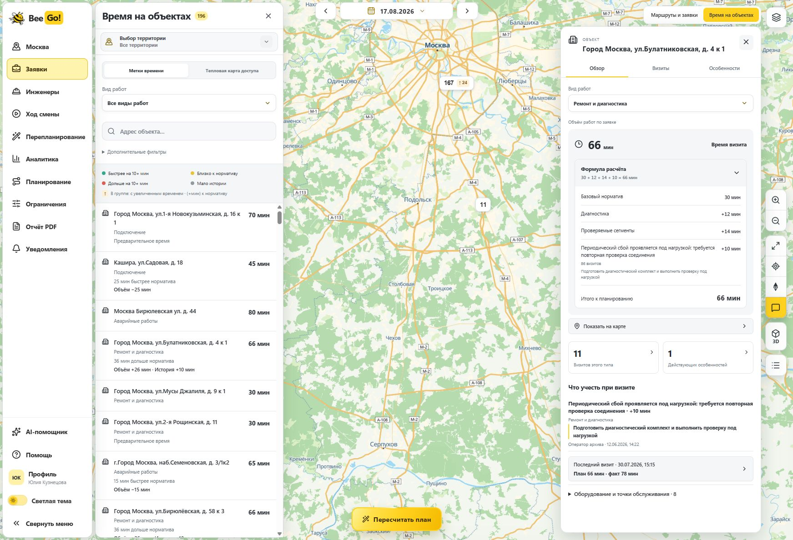
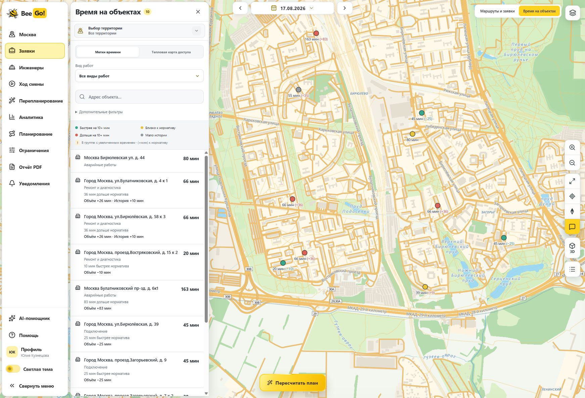
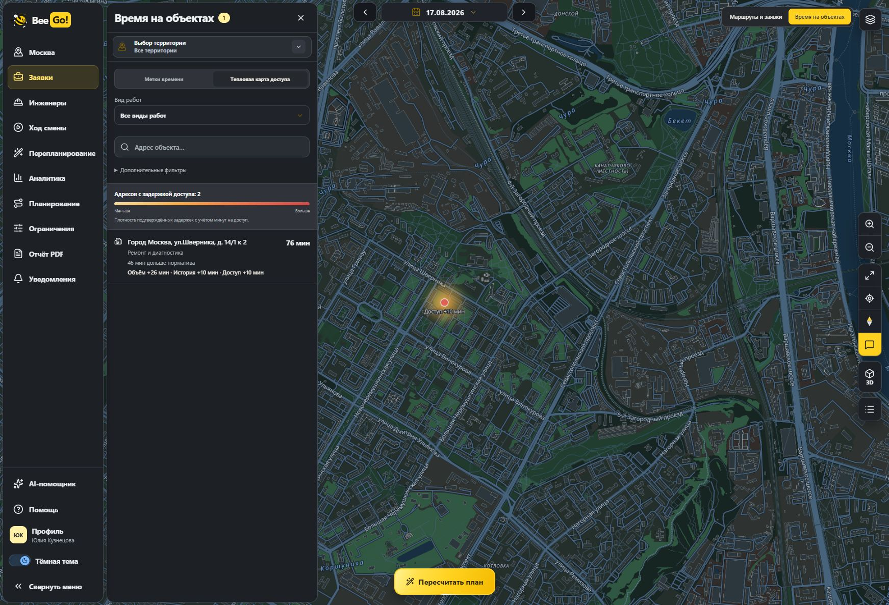
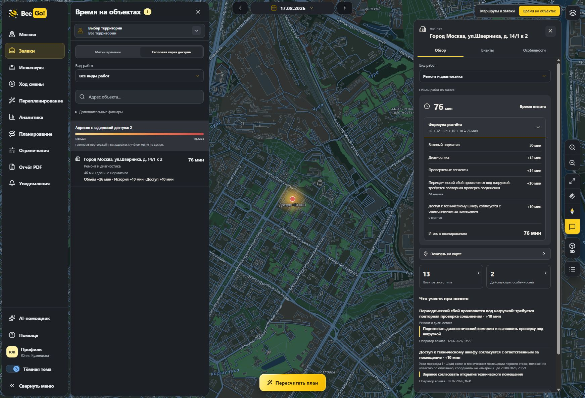
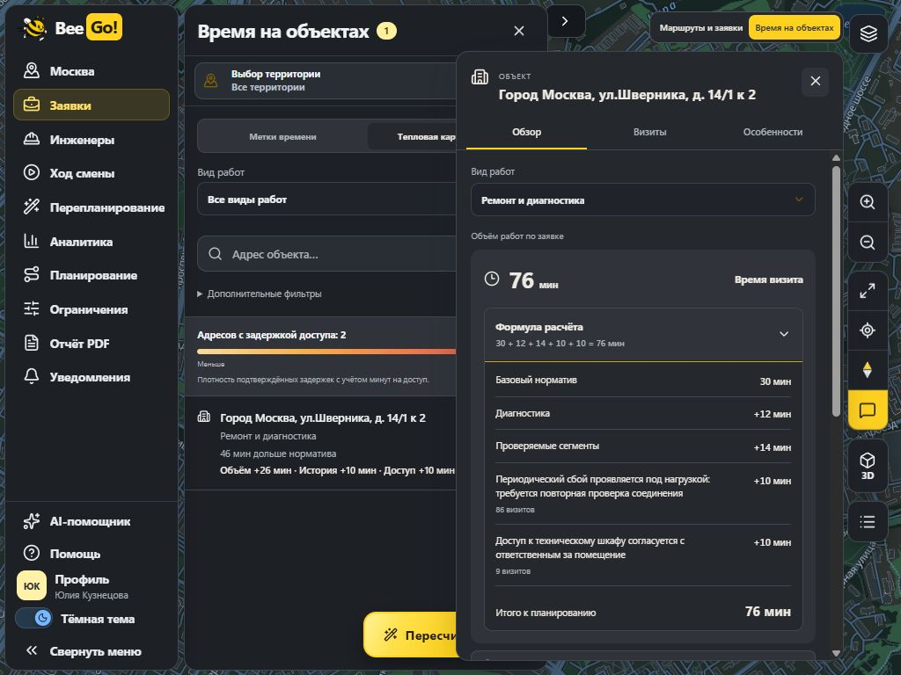
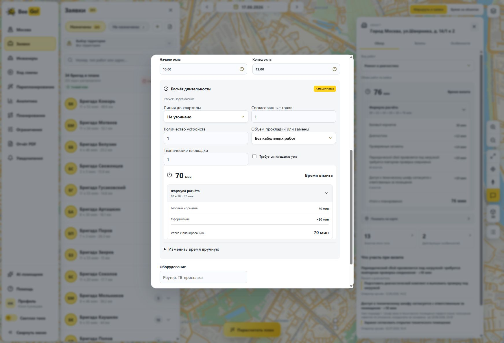

# Формула длительности, дельты и тепловая карта доступа

Кандидат: http://127.0.0.1:4199/. Ветка: `feat/duration-formula-access-heatmap`.

## Где смотреть

- Форма добавления заявки и паспорт объекта → «Формула расчёта» сразу под временем визита. Даже в свёрнутом виде видны слагаемые и итог. При раскрытии показаны норматив, факторы состава работ, конкретные подтверждённые причины поправок, количество визитов, оформление, доступ и ручная корректировка с причиной. Математика берётся из авторитетного снимка; нормативы и модель не изменялись.
- Основная карта → «Время на объектах» → «Метки времени»: рядом со временем видна дельта к нормативу, например `66 мин (+36)`. Положительная дельта выделена красным, отрицательная — зелёным. Кластеры остаются компактными и сохраняют точные количества.
- В том же режиме → «Тепловая карта доступа»: интенсивность зависит от подтверждённых минут доступа и плотности точек. На районном масштабе подпись показывает именно `Доступ +10 мин`. Применяются те же фильтры и список адресов. Большой объём заказа и неизвестный доступ не создают пятен. В текущем представлении на 17.08.2026 подтверждённое дополнительное время доступа есть у двух адресов; сплошные проблемные зоны не выдумывались.
- Аналитика → «Эффективность» → карточка «Предотвращено опозданий». За 11–17 августа в учебной истории проверены 84 завершённых визита с полным измерением и прогнозом до начала. Для 21 визита прогноз включал 830 минут сверх стандартного норматива. Это статистика учтённого времени, а не доказанные предотвращённые опоздания. Число предотвращённых опозданий остаётся неизвестным (`null`), статус — «Нужно сравнение планов». Методика раскрывается отдельно.

Для доказательства предотвращённых опозданий нужны сопоставимые независимо проверенные расписания на одних заявках и дорогах с одинаковыми ограничениями: с нормативом и с адаптивным временем. Сравниваются приезды после конца клиентского окна. Утверждение «предотвращено 42» не добавлено без такого расчёта.

## Проверки

- Полный набор: 221/221 JS-тест, без пропусков; заключительные проверки формулы, истории и карт после последних правок — 19/19.
- Формула: точная сумма, отсутствие двойного учёта доступа/истории/оформления, отрицательные поправки, минимум работы и ручное изменение. Снимки остаются неизменными.
- Неделя: границы семи календарных дней Москвы, исключение неполных/исключённых измерений, ручных и рассчитанных после начала визита прогнозов. Отсутствие доказательств не превращается в ноль предотвращённых опозданий.
- MapLibre: проверка спецификации всех новых слоёв штатным валидатором установленной библиотеки — без ошибок. Тесты проверяют фильтрацию теплового источника, переключение режимов, восстановление после смены стиля и отключение слоёв вне режима времени.
- `pnpm build`, `git diff --check`: успешно. Сохраняется предупреждение Vite о размере общего JS-бандла.
- Браузер: светлая и тёмная темы, город и район, формула Булатниковской `30 + 12 + 14 + 10 = 66`, формула Шверника с доступом `30 + 12 + 14 + 10 + 10 = 76`, дельты маркеров, переходы между тепловым слоем и метками, паспорт, фильтры, аналитика и окно 1024×768. Формула и документ не имеют горизонтального переполнения.
- Паспорт открывается нажатием на точку теплового слоя; формула раскрывается клавишей Enter. Фильтр «Подключение» даёт ноль подтверждённых задержек доступа и отдельное пустое состояние; возврат к «Все виды работ» возвращает два адреса. В DOM остаётся один canvas карты.
- В форме новой заявки стандартное подключение показывает `60 + 10 = 70` и отдельную строку оформления. Проверочные формы закрыты без добавления заявок.

Прежний проверенный план 203/205 сохранён; новый полный поиск не запускался. Новых production-зависимостей нет. `main`, модель длительности, синтетическая история и исходный стенд 4188 не изменены.

Логи: `runtime/qa/duration-transparency/`.

## Скриншоты

