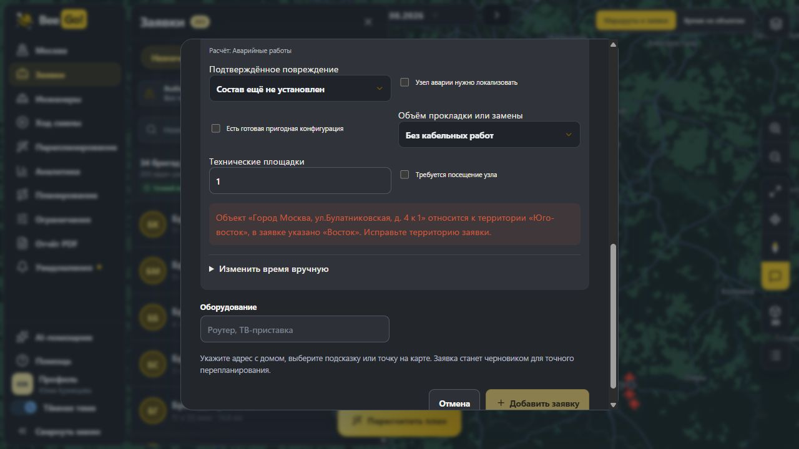
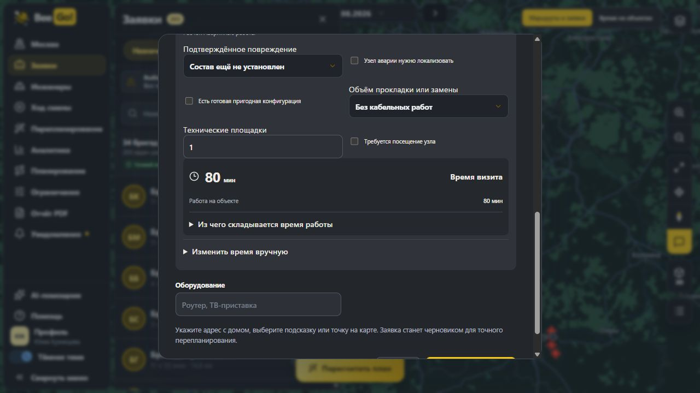
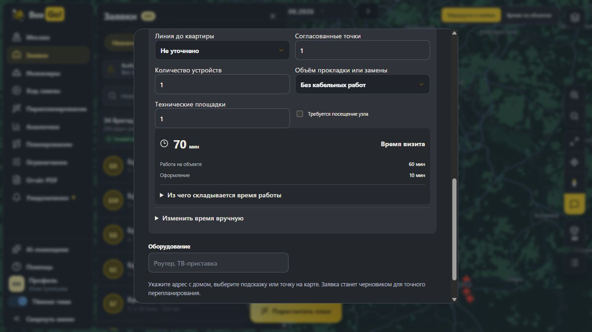

# Территория заявки и единое правило вида работ

Кандидат: http://127.0.0.1:4199/. Ветка: `fix/server-territory-work-semantics`.

## Исправления

- Сервер сверяет территорию с реестром по ID объекта, исходному ID точки или единственному совпадению нормализованного адреса. Проверяются также исходные `zone_name`/`zone_id`; отсутствие ID объекта в CSV не обходит защиту. Противоречие возвращает HTTP 422 с номером строки, заявкой, адресом и правильной территорией.
- Импорт проверяется до изменения локального набора. Повторная серверная защита действует при подготовке длительностей, первоначальном расчёте, создании события добавления, сохранении смены, готовности черновика и публикации. Ошибочная территория не создаёт черновик и снимки длительности. Неизвестный реестру адрес не связывается с ближайшим объектом по догадке; неоднозначный адрес требует выбора объекта.
- Общий контракт `site/src/orderSemantics.json` задаёт вид работы, квалификацию и приоритет очереди для JS и Python. Его используют форма, импорт, длительности, маркеры, аналитика, сравнение с базовым планом, первоначальный подбор кандидатов и перепланирование событий.
- Снимок длительности от другого вида работ нельзя повторно использовать после изменения приоритета на аварийный.

Для стандартного подключения без дополнительных факторов:

| Приоритет | Расчёт | Квалификация | Очередь |
| --- | --- | --- | --- |
| Обычная | Подключение, 70 мин | INSTALL | NORMAL |
| Срочная / URGENT | Подключение, 70 мин | INSTALL | URGENT |
| Авария / EMERGENCY / CRITICAL | Аварийные работы, 80 мин | EMERGENCY | URGENT |

Информационная заявка остаётся отдельным видом работы; сама группа «Глобальная проблема» не делает информационный визит аварией. Явная срочность при этом сохраняется.

## Проверка 17.10.2026

- `node --test tests/*.test.mjs`: 217/217, без пропусков.
- Python: 13/13 (`test_ui_work_semantics`, `test_import_equipment`, `test_duration_contract`). Проверены реальные подготовка `jobs.csv`, загрузка набора алгоритма и построение индекса кандидатов для первоначального расчёта и NEW_ORDER. INSTALL-only исключён для подключения с «Аварией»; EMERGENCY-only допускается при остальных подходящих ограничениях.
- JS/Python: совпадение контракта на десяти сценариях, включая исходные CSV-поля и информационные работы.
- `pnpm build` и `git diff --check`: успешно. Vite сохраняет предупреждение о размере общего JS-бандла.
- Браузер: CSV с Булатниковской, 4 к 1 и зоной «Восток» показывает серверную ошибку, добавление отключено. После выбора «Юго-восток» ошибка исчезает. Подключение с «Аварией» показывает 80 мин; переключение на «Срочная» — 70 мин.
- Прямой запрос к работающему 4199 без ID объекта: неверная зона — 422, правильная — 200 с реестровым ID. Серверные расчёты подтверждают `emergency/80` и `connection/70`.
- Временные тестовые снимки удалены после сохранения их копии в QA-каталоге; тестовые заявки и черновики в кандидатную смену не добавлялись. Отдельный QA-сервер 4200 остановлен.

Существующий проверенный план 203/205 и 34 бригады сохранён. Полный новый поиск расписания для этих исправлений не запускался. `main` и исходный стенд 4188 не изменялись.

Логи и ответы API: `runtime/qa/server-territory-semantics/` (локальные файлы).

## Скриншоты

